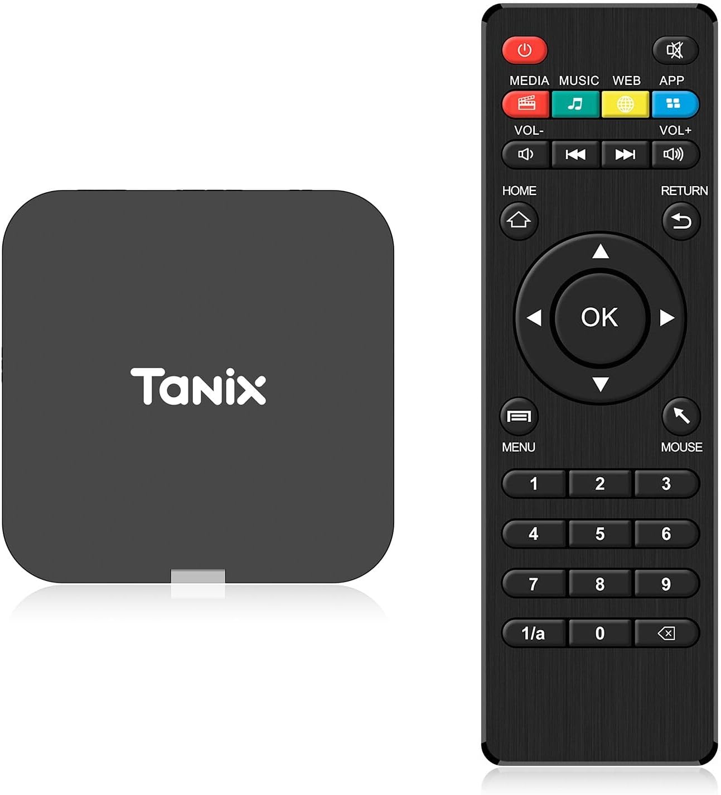

# TVBian for Allwinner TV boxes

[](https://github.com/sormy/tvbian/releases/latest)
[](https://github.com/sormy/tvbian/releases/latest)
[](https://github.com/sormy/tvbian/actions/workflows/release.yml)

Debian on an Allwinner Android TV box: mainline Linux, our drivers, a weekly signed image. Rockchip
boxes are in [README.md](README.md), Amlogic ones in [README_AMLOGIC.md](README_AMLOGIC.md).

**Host: macOS or Linux.** Not Windows.

## Boxes

| Box                                                  | Board                                                            | Hardware                                                                                                       | Install          |
| ---------------------------------------------------- | ---------------------------------------------------------------- | -------------------------------------------------------------------------------------------------------------- | ---------------- |
|  | **Tanix TX1 V2.0**<br>`QHZIW_H313_TX1_EMCP_V2.0`<br>`2024-03-21` | SoC H313<br>2 GB RAM (1.5 GiB) · 16 GB eMMC<br>USB-A 2.0 · AV jack<br>**no Ethernet** · ATBM6031-X Wi-Fi + BLE | [2](#2-fel): FEL |

[doc]: docs/tanix-tx1-v2/board.md

## What works

| Mark | Means                                                                |
| :--: | -------------------------------------------------------------------- |
|  ✅  | tested here — the number behind it is in the [board doc][doc]        |
|  🟡  | likely — a proven mechanism backs it and nothing indicates a problem |
|  🟠  | works, measurably short of its siblings or stock                     |
|  ❓  | never tested                                                         |
|  ❌  | broken                                                               |
|  ➖  | not on this board                                                    |

| Hardware                                        | Tanix TX1 V2.0 |
| ----------------------------------------------- | :------------: |
| **Storage**                                     |                |
| eMMC — boot and rootfs                          |       ✅       |
| USB stick — boot and rootfs                     |       ✅       |
| microSD                                         |       ➖       |
| USB 2.0                                         |       ✅       |
| **Network**                                     |                |
| Ethernet                                        |       ➖       |
| Wi-Fi 2.4 GHz                                   |       ✅       |
| Wi-Fi 5 GHz                                     |       ➖       |
| Bluetooth LE, off by default                    |       ✅       |
| Wi-Fi with BLE on                               |       🟠       |
| **Display and video**                           |                |
| HDMI video                                      |       ✅       |
| HDMI audio                                      |       ✅       |
| HDMI-CEC                                        |       🟡       |
| HDMI HDR10                                      |       ✅       |
| HDMI 10-bit                                     |       ❓       |
| AV jack — composite video                       |       ❌       |
| AV jack — audio                                 |       ❌       |
| GPU — Mali-G31 under Panfrost                   |       ✅       |
| Hardware decode — H.264, VP8 to 4K              |       ✅       |
| Hardware decode — HEVC, VP9 to 8K, 10-bit to 6K |       ✅       |
| Hardware decode — MPEG-2                        |       ✅       |
| Hardware decode — MPEG-1                        |       ❌       |
| Hardware decode — VC-1, Main profile refused    |       🟠       |
| Hardware decode — JPEG, Motion JPEG             |       ✅       |
| Hardware decode — MPEG-4 ASP, Xvid, H.263       |       🟠       |
| Hardware encode — H.264, JPEG to 4K             |       ✅       |
| Deinterlace                                     |       ✅       |
| **Input and indicators**                        |                |
| Bundled remote over IR                          |       ✅       |
| BLE remote, with BLE on                         |       ✅       |
| Recovery button (U-Boot)                        |       ✅       |
| Power and standby LEDs                          |       ✅       |
| **Power and recovery**                          |                |
| CPU frequency scaling                           |       ✅       |
| Hardware watchdog                               |       ✅       |
| Sleep and wake from the remote                  |       ✅       |
| Deep suspend                                    |       ❌       |
| Serial console                                  |       ✅       |
| eMMC backup over FEL                            |       ✅       |

## Get an image

Every box's image is on the [latest release](https://github.com/sormy/tvbian/releases/latest), with
signed checksums. Build it yourself instead with `./build.sh`: [docs/build.md](docs/build.md).

## Install

| Route                              | The box needs  | State |
| ---------------------------------- | -------------- | ----- |
| 1. SD card, then `tvb-install`     | an SD slot     | 🟡    |
| 2. FEL: the image written over USB | the FEL button | ✅    |

Route 1 runs TVBian from the card before anything is written to the eMMC: the safer one, where the
box has a slot. Route 2 writes the image straight to the eMMC; the FEL button stays the way back.

**Back up first:** only the backup brings Android back.

### 1. SD card

The boot ROM tries an SD card before the eMMC. Write the image to a card and boot the box from it;
pull the card and Android boots as before. To keep TVBian: `sudo tvb-install`, then pull the card.

### 2. FEL

Back up, then install, as [docs/allwinner-fel.md](docs/allwinner-fel.md) describes, with the image
from the release. Then unplug the cable and power the box on without the button: it boots the eMMC.

### A USB stick, once TVBian is installed

TVBian's bootloader tries a USB stick before the eMMC. Write an image to a stick, plug it in and
power on: the box runs it, the eMMC untouched; `sudo tvb-install` from it reinstalls. Pull the stick
and the eMMC boots again. Android's own bootloader ignores the stick, so this needs TVBian installed
once.

Then log in: `ssh root@<hostname>.local`, password `1234`, expired, so pick a new one. A user, the
timezone, the locale and Wi-Fi: [docs/first-login.md](docs/first-login.md).

## Update a running box

```bash
sudo apt update && sudo apt upgrade
```

## Serial console

For debugging. **3.3 V, 115200 baud** — any 3.3 V USB-TTL adapter does it.

| Board          | Pads, in order |
| -------------- | -------------- |
| Tanix TX1 V2.0 | VCC RX TX GND  |

GND, TX and RX only, crossed (box TX → adapter RX). **Never connect 3V3/VCC.**

## License

Scripts MIT. Vendor blobs keep their own licenses.
