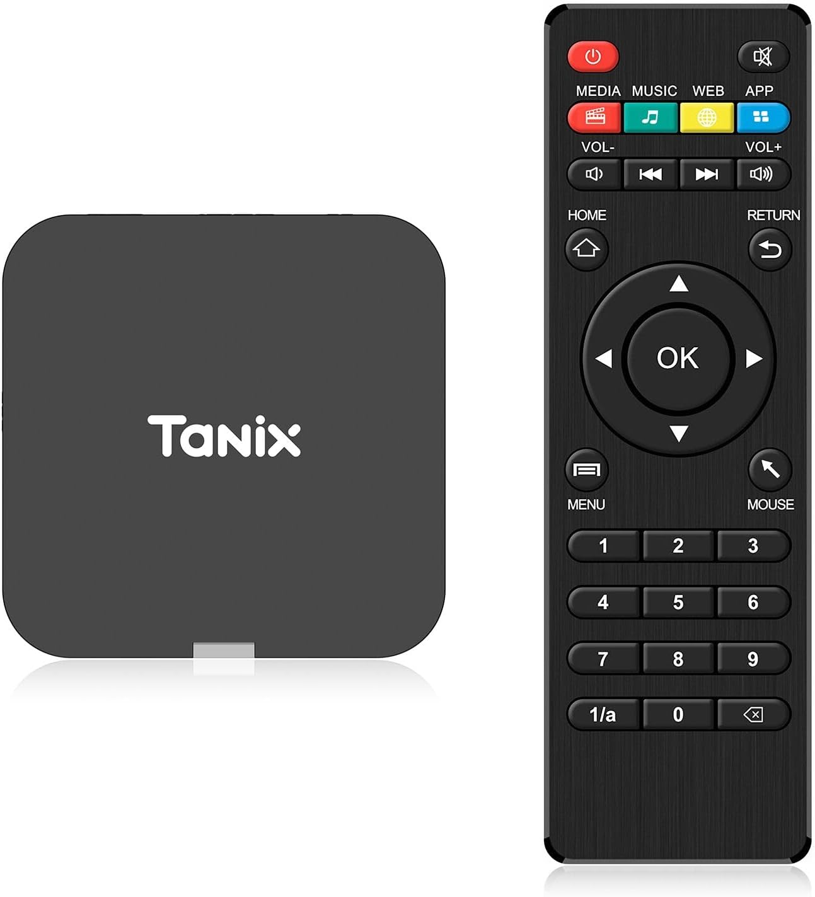
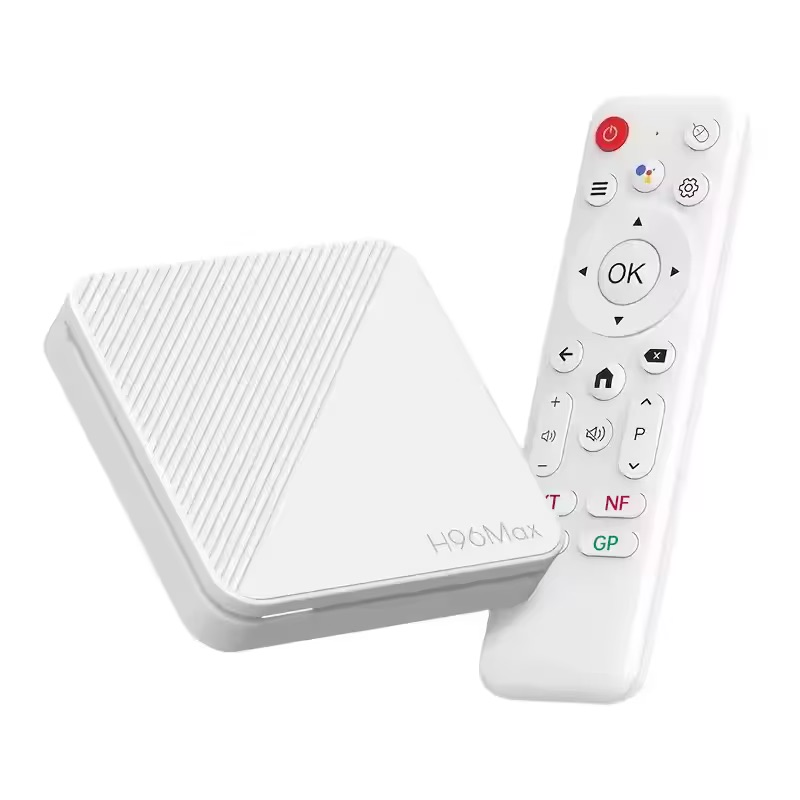
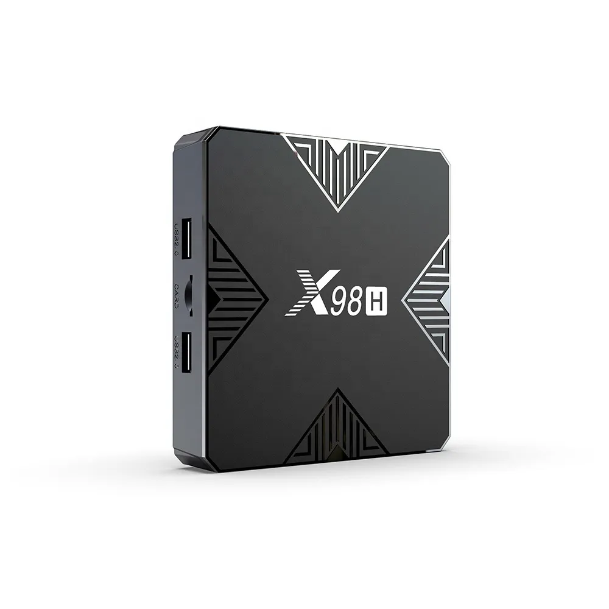

# TVBian for Allwinner TV boxes

[](https://github.com/sormy/tvbian/releases/latest)
[](https://github.com/sormy/tvbian/releases/latest)
[](https://github.com/sormy/tvbian/actions/workflows/release.yml)

Debian on an Allwinner Android TV box: mainline Linux, our drivers, a weekly signed image. Rockchip
boxes are in [README_ROCKCHIP.md](README_ROCKCHIP.md), Amlogic ones in
[README_AMLOGIC.md](README_AMLOGIC.md).

**Host: macOS or Linux.** Not Windows.

## Boxes

| Box                                                  | Board                                                                   | Hardware                                                                                                                                            | Install                                                  |
| ---------------------------------------------------- | ----------------------------------------------------------------------- | --------------------------------------------------------------------------------------------------------------------------------------------------- | -------------------------------------------------------- |
|  | **[Tanix TX1 V2.0][doc]**<br>`QHZIW_H313_TX1_EMCP_V2.0`<br>`2024-03-21` | SoC H313 · 1.5 GB RAM LPDDR3 (sold as 2 GB) · 16 GB eMMC DDR52 · **no SD** · USB-A 2.0 (OTG) · **no LAN** · ATBM6031-X Wi-Fi + BLE · HDMI · AV · IR | [2](#2-otg-cable): OTG cable                             |
|  | **[H96 Max H313][h313]**<br>`BA979_627_V1.0`                            | SoC H313 · 2 GB RAM LPDDR3 · 16 GB eMMC HS200 · SD HS · USB-A 2.0 (OTG) + USB-A 2.0 · LAN 100M · AIC8800D40L Wi-Fi + BLE · HDMI · AV · IR           | [1](#1-sd-card): SD card<br>[2](#2-otg-cable): OTG cable |
|         | **[X98H][x98h]** ❓<br>`YB927_141_V1.1`                                 | SoC H618 · 4 GB RAM DDR3 · 32 GB eMMC HS200 · SD · 3 × USB-A 2.0 · LAN 100M · AIC8800D80 Wi-Fi + BT · HDMI · AV · S/PDIF · IR · LED display         | [1](#1-sd-card): SD card<br>[2](#2-otg-cable): OTG cable |

[doc]: docs/tanix-tx1-v2/board.md
[x98h]: docs/x98h/board.md
[h313]: docs/h96max-h313/board.md

## Memory

Read bandwidth from the CPU, `stress-ng --stream` for 15 s on one core, then four. Video and the
display read the same RAM: little to spare starves them at 4K.

| Board          | RAM    | Channels |   Clock |   1 core |  4 cores |
| -------------- | ------ | -------: | ------: | -------: | -------: |
| Tanix TX1 V2.0 | LPDDR3 |        1 | 600 MHz | 861 MB/s | 841 MB/s |
| H96 Max H313   | LPDDR3 |        1 | 600 MHz | 858 MB/s | 831 MB/s |

On the H616, 4K reaches the screen only as compressed (AFBC) frames: linear 4K frames underflow the
display's FIFO and break up, 10-bit worst.

## What works

| Mark | Means                                                                |
| :--: | -------------------------------------------------------------------- |
|  ✅  | tested here — the number behind it is in the board's doc             |
|  🟡  | likely — a proven mechanism backs it and nothing indicates a problem |
|  ❓  | never tested                                                         |
|  🟠  | works, measurably short of its siblings or stock                     |
|  ❌  | broken                                                               |
|  ➖  | not on this board                                                    |

| Hardware                                        | Tanix<br>TX1 V2.0 | H96 Max<br>H313 | X98H |
| ----------------------------------------------- | :---------------: | :-------------: | :--: |
| **Storage**                                     |                   |                 |      |
| eMMC — boot and rootfs                          |        ✅         |       ❓        |  ❓  |
| USB stick — boot and rootfs                     |        ✅         |       ❓        |  ❓  |
| SD — boot and rootfs                            |        ➖         |       ✅        |  ❓  |
| SD SDR104 (UHS)                                 |        ➖         |       ❓        |  ❓  |
| USB 2.0                                         |        ✅         |       ✅        |  ❓  |
| **Network**                                     |                   |                 |      |
| LAN 100M                                        |        ➖         |       ✅        |  🟡  |
| Wi-Fi 2.4 GHz                                   |        ✅         |       🟡        |  ❓  |
| Wi-Fi 5 GHz                                     |        ➖         |       ✅        |  🟡  |
| Bluetooth LE                                    |        ✅         |       ✅        |  🟡  |
| Wi-Fi with BLE on                               |        🟠         |       ✅        |  🟡  |
| **Display and video**                           |                   |                 |      |
| HDMI video                                      |        ✅         |       ✅        |  🟡  |
| HDMI audio                                      |        ✅         |       ✅        |  🟡  |
| HDMI-CEC                                        |        ✅         |       ✅        |  🟡  |
| HDMI HDR10                                      |        ✅         |       ✅        |  🟡  |
| HDMI 10-bit, as 4:2:0 at 4K only                |        🟠         |       ❓        |  ❓  |
| AV jack — composite video                       |        🟡         |       ✅        |  🟡  |
| AV jack — audio                                 |        🟡         |       ✅        |  🟡  |
| GPU — Mali-G31 under Panfrost                   |        ✅         |       ✅        |  🟡  |
| Hardware decode — H.264, VP8 to 4K              |        ✅         |       ✅        |  🟡  |
| Hardware decode — HEVC, VP9 to 8K, 10-bit to 6K |        ✅         |       ✅        |  🟡  |
| Hardware decode — MPEG-2                        |        ✅         |       ✅        |  🟡  |
| Hardware decode — MPEG-1                        |        ❌         |       ❌        |  ❓  |
| Hardware decode — VC-1, Main profile refused    |        🟠         |       ❓        |  ❓  |
| Hardware decode — JPEG, Motion JPEG             |        ✅         |       ✅        |  🟡  |
| Hardware decode — MPEG-4 ASP, Xvid, H.263       |        🟠         |       🟠        |  ❓  |
| Hardware encode — H.264, JPEG to 4K             |        ✅         |       ✅        |  🟡  |
| Deinterlace                                     |        ✅         |       ✅        |  🟡  |
| **Input and indicators**                        |                   |                 |      |
| Bundled remote over IR                          |        ✅         |       ❓        |  ❓  |
| BLE remote, with BLE on                         |        ✅         |       ❓        |  ❓  |
| Recovery button: FEL from our U-Boot            |        🟡         |       ✅        |  ❓  |
| Power and standby LEDs                          |        ✅         |       ✅        |  ❓  |
| **Power and recovery**                          |                   |                 |      |
| CPU frequency scaling                           |        ✅         |       ✅        |  🟡  |
| Hardware watchdog                               |        ✅         |       ✅        |  🟡  |
| Sleep and wake from the remote                  |        ✅         |       ❓        |  ❓  |
| Deep suspend                                    |        ❌         |       ❌        |  ❓  |
| Serial console                                  |        ✅         |       ❓        |  ❓  |
| eMMC backup over FEL                            |        ✅         |       ✅        |  ❓  |
| eMMC install over FEL                           |        ✅         |       ✅        |  ❓  |

## Get an image

Every box's image is on the [latest release](https://github.com/sormy/tvbian/releases/latest), with
signed checksums. Build it yourself instead with `./build.sh`: [docs/build.md](docs/build.md).

## Back up first

Before anything is written to the eMMC; running from an SD card needs none. Over FEL, the whole eMMC
to a file on the host, as `docs/allwinner-fel.md` describes: only the backup brings Android back.
The Tanix TX1 V2.0 has no microSD slot, so FEL is its only way in.

## Install

| Route                                  | The box needs | Tanix TX1 V2.0 | H96 Max H313 | X98H |
| -------------------------------------- | ------------- | :------------: | :----------: | :--: |
| 1. SD card, then `tvb-install`         | an SD slot    |    ➖ no SD    |      ✅      |  🟡  |
| 2. OTG cable: the image written in FEL | a button      |       ✅       |      ✅      |  🟡  |

Route 1 runs TVBian from the card before anything touches the eMMC, so it is the safer one. Route 2
writes the image straight to the eMMC.

A box hides one or two buttons behind a toothpick hole. A FEL button is wired to the chip and
reaches FEL whatever is on the eMMC. A recovery button is read by the bootloader: TVBian's U-Boot
sends it to FEL as well, but only while that bootloader runs; if it does not, boot from an SD card.
Some boxes have one kind, some both. Each board's `board.md` says which.

### 1. SD card

The boot ROM tries an SD card before the eMMC. Write the image to a card and boot the box from it;
pull the card and Android boots as before. To keep TVBian: `sudo tvb-install`, then pull the card.

### 2. OTG cable

Back up, then install, as [docs/allwinner-fel.md](docs/allwinner-fel.md) describes, with the image
from the release. Then unplug the cable and power the box on without the button: it boots the eMMC.

### A USB stick, once TVBian is installed

TVBian's bootloader tries a USB stick before the eMMC. Write an image to a stick, plug it in and
power on: the box runs it, the eMMC untouched; `sudo tvb-install` from it reinstalls. Pull the stick
and the eMMC boots again. Android's own bootloader ignores the stick, so this needs TVBian installed
once.

## First login

`ssh root@<hostname>.local`, password `1234`, expired, so pick a new one. A user, the timezone, the
locale and Wi-Fi: [docs/first-login.md](docs/first-login.md).

## Update a running box

```bash
sudo apt update && sudo apt upgrade
```

## Serial console

For debugging. **3.3 V, 115200 baud** — any 3.3 V USB-TTL adapter does it.

| Board          | Pads, in order             |
| -------------- | -------------------------- |
| Tanix TX1 V2.0 | VCC RX TX GND              |
| H96 Max H313   | RX TX GND                  |
| X98H           | GND TX RX, from the corner |

GND, TX and RX only, crossed (box TX → adapter RX). **Never connect 3V3/VCC.**

## Recovery

Write the backup back over FEL, as `docs/allwinner-fel.md`'s restore describes, and Android returns
as it was. If the button no longer works, boot TVBian from an SD card and restore from there.

## License

Scripts MIT. Vendor blobs keep their own licenses.
