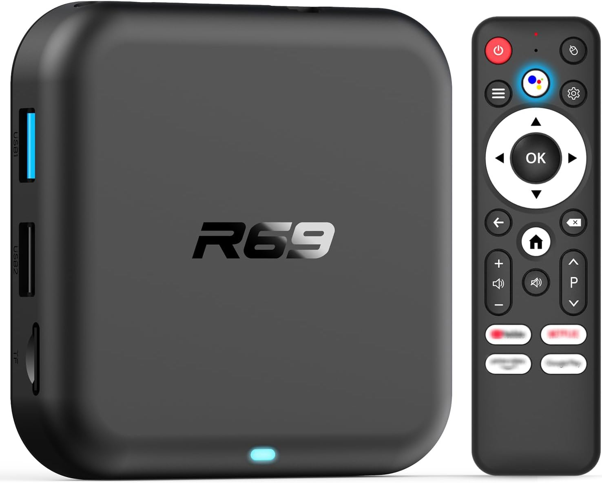
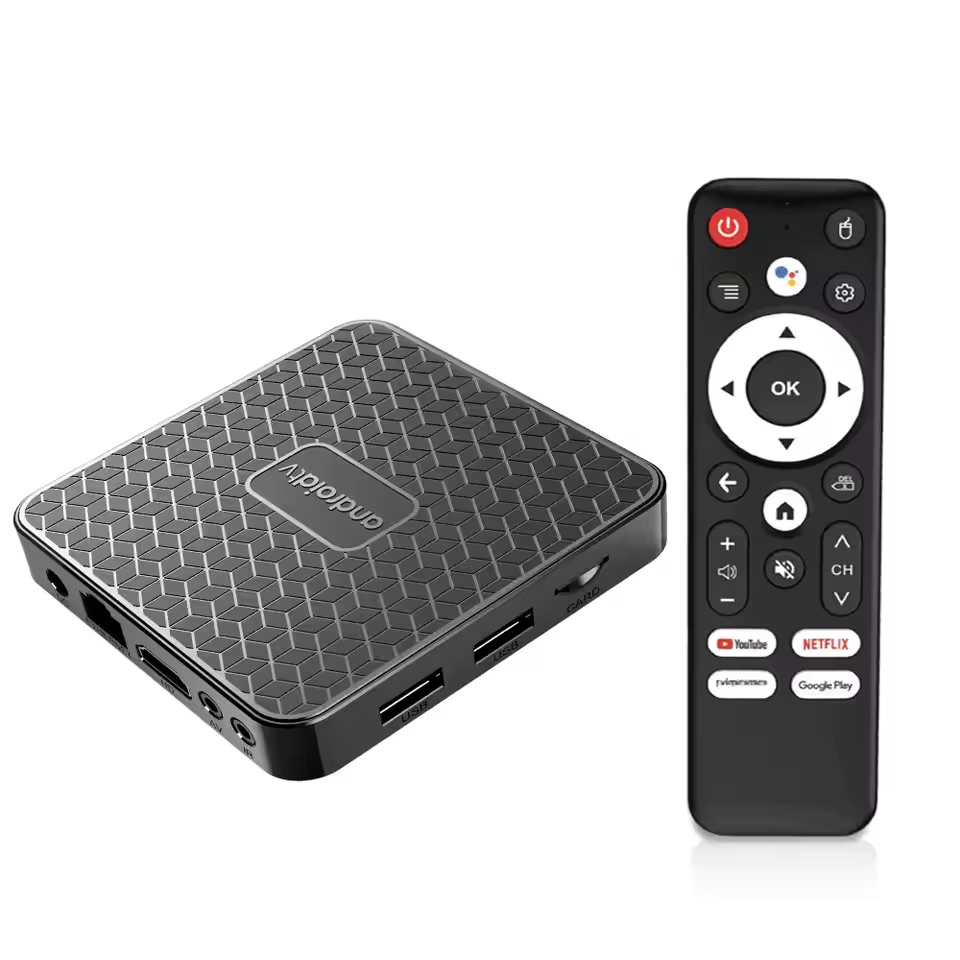
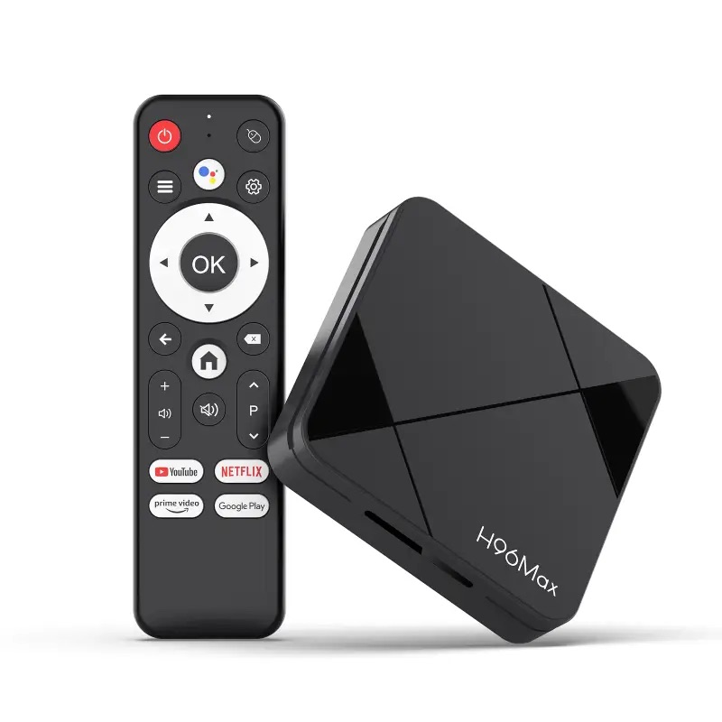
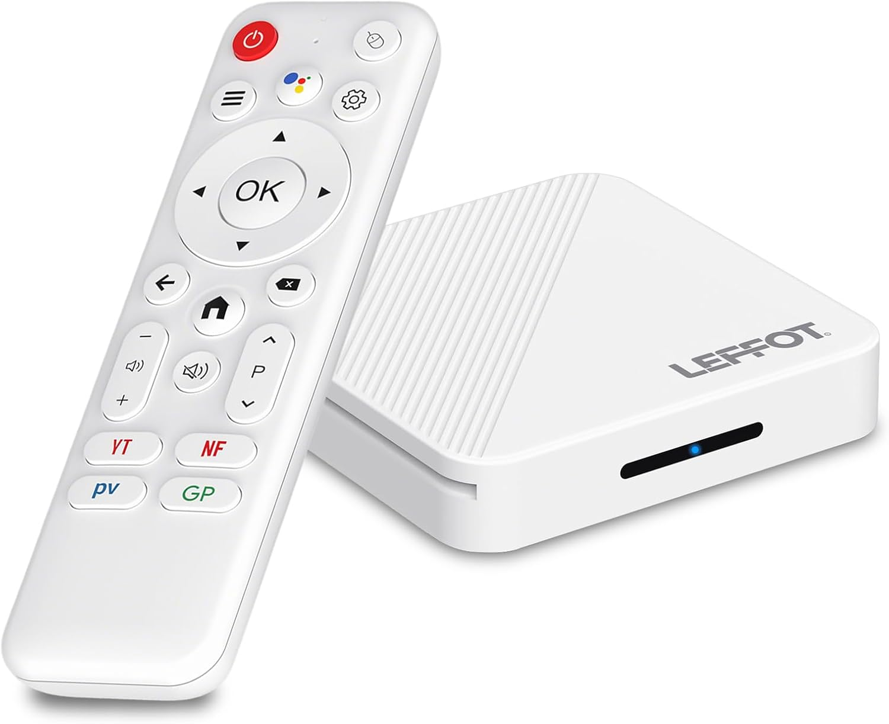
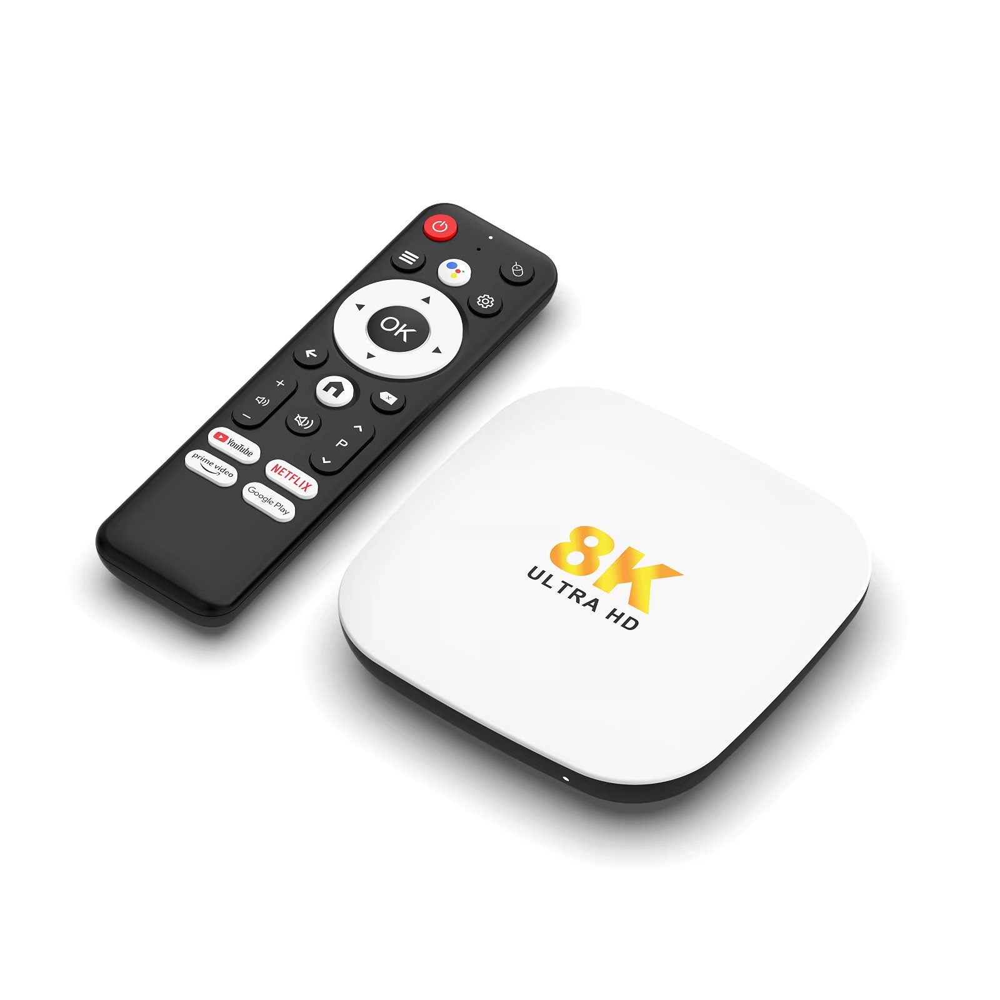
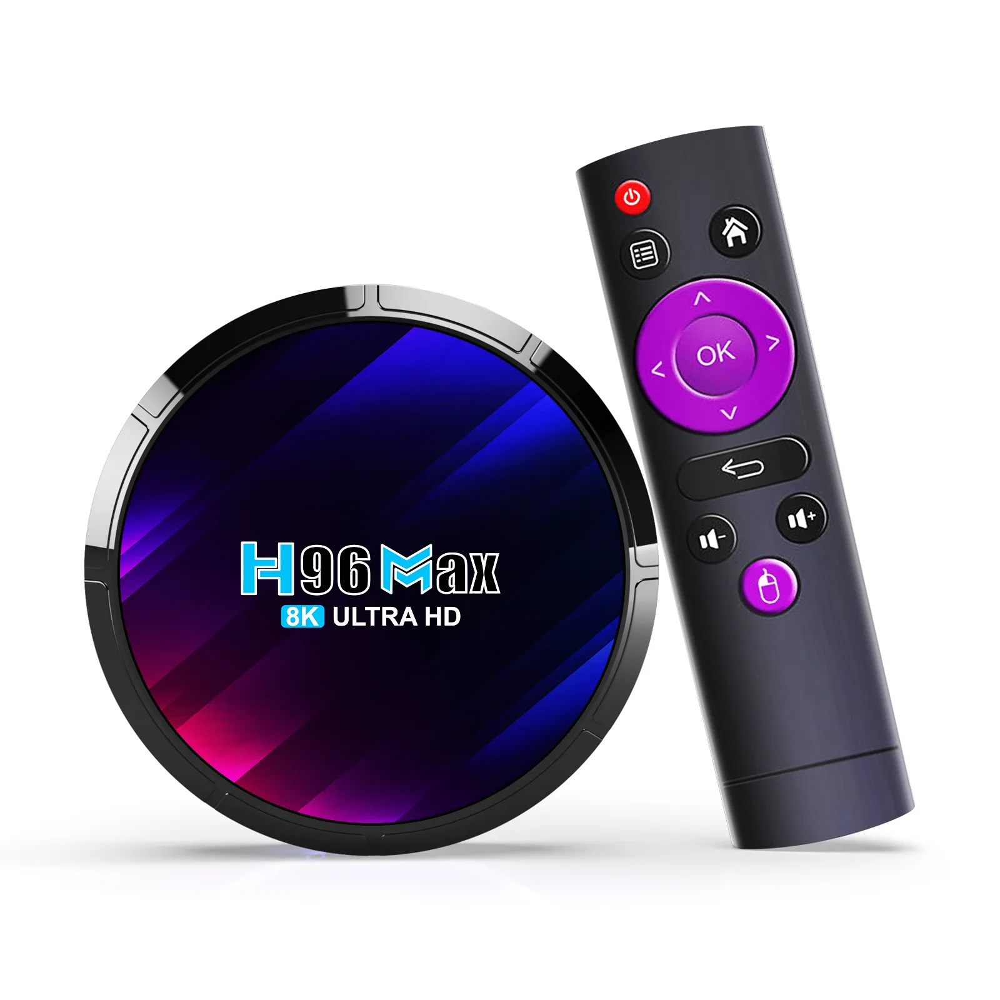

# TVBian for Rockchip TV boxes

[](https://github.com/sormy/tvbian/releases/latest)
[](https://github.com/sormy/tvbian/releases/latest)
[](https://github.com/sormy/tvbian/actions/workflows/release.yml)

Debian on a Rockchip Android TV box: Rockchip's own kernel, our drivers, a weekly signed image.
Amlogic boxes are in [README_AMLOGIC.md](README_AMLOGIC.md), Allwinner ones in
[README_ALLWINNER.md](README_ALLWINNER.md).

**Host: macOS or Linux.** Not Windows.

## Boxes

| Box                                                    | Board                                                          | Hardware                                                                                                                      | Install                                                  |
| ------------------------------------------------------ | -------------------------------------------------------------- | ----------------------------------------------------------------------------------------------------------------------------- | -------------------------------------------------------- |
|           | **[R69-1][r69]**<br>`XR821_V1.1`                               | SoC RK3518<br>2 GB RAM (1.5 GB usable) · 16 GB eMMC<br>USB-A 3.0 (OTG) + USB-A 2.0<br>10/100 Ethernet · AIC8800D80 Wi-Fi + BT | [1](#1-sd-card): SD card<br>[2](#2-otg-cable): OTG cable |
|             | **T8S**<br>`R69MAX V1.1`<br>an R69-1: its image                | SoC RK3518<br>2 GB RAM (usable ❓) · 8 GB eMMC<br>USB-A 3.0 (OTG) + USB-A 2.0<br>10/100 Ethernet · AIC8800D80 Wi-Fi + BT      | [1](#1-sd-card): SD card<br>[2](#2-otg-cable): OTG cable |
|     | **[H96 Max 3518][h96]**<br>`3518_ZX_V01`<br>`2025-08-18`       | SoC RK3518<br>2 GB RAM · 16 GB eMMC<br>USB-A 3.0 (OTG) + USB-A 2.0<br>10/100 Ethernet · SWT6621S Wi-Fi + BT                   | [1](#1-sd-card): SD card<br>[2](#2-otg-cable): OTG cable |
|     | **Leffot H313**<br>`3518_ZX_V01`<br>an H96 Max 3518: its image | SoC RK3518<br>2 GB RAM · 16 GB eMMC<br>USB-A 3.0 (OTG) + USB-A 2.0<br>10/100 Ethernet · SWT6621S Wi-Fi + BT                   | [1](#1-sd-card): SD card<br>[2](#2-otg-cable): OTG cable |
|    | **[H96 Max 3518D][h96d]**<br>`3518_DG_ZX_V01`<br>`2025-04-01`  | SoC RK3518<br>2 GB RAM · 16 GB eMMC, **no SD slot**<br>USB-C 2.0 (OTG) + USB-A 2.0<br>**no Ethernet** · SWT6621S Wi-Fi + BT   | [2](#2-otg-cable): OTG cable                             |
|  | **[H96 Max M2 Plus][m2p]**<br>`M2_P_ZX_20250328`               | SoC RK3528<br>4 GB RAM · 32 GB eMMC, **no SD slot**<br>USB-A 3.0 (OTG)<br>10/100 Ethernet · SWT6621S Wi-Fi + BT               | [2](#2-otg-cable): OTG cable                             |
|   | **[H96 Max RK3528][rk3528]** ❓<br>`RK3528_DDR3_8X4_V12`       | SoC RK3528<br>4 GB RAM · 64 GB eMMC<br>USB-A 3.0 (OTG) + USB-A 2.0<br>10/100 Ethernet · AIC8800D80 Wi-Fi + BT<br>Front LCD    | [1](#1-sd-card): SD card<br>[2](#2-otg-cable): OTG cable |

[r69]: docs/r69-1/board.md
[h96]: docs/h96max-3518/board.md
[h96d]: docs/h96max-3518d/board.md
[m2p]: docs/h96max-m2-plus/board.md
[rk3528]: docs/h96max-rk3528/board.md

## What works

| Mark | Means                                                                |
| :--: | -------------------------------------------------------------------- |
|  ✅  | tested here — the number behind it is in the board's doc             |
|  🟡  | likely — a proven mechanism backs it and nothing indicates a problem |
|  ❓  | never tested                                                         |
|  🟠  | works, measurably short of its siblings or stock                     |
|  ❌  | broken                                                               |
|  ➖  | not on this board                                                    |

An alias runs its board's image unchanged, so it reads that board's column:

| Board       | PCB           | Alias of     |
| ----------- | ------------- | ------------ |
| T8S         | `R69MAX V1.1` | R69-1        |
| Leffot H313 | `3518_ZX_V01` | H96 Max 3518 |

| Hardware / Board                                  | R69-1 | H96 Max<br>3518 | H96 Max<br>3518D | H96 Max<br>M2 Plus | H96 Max<br>RK3528 |
| ------------------------------------------------- | :---: | :-------------: | :--------------: | :----------------: | :---------------: |
| **Storage**                                       |       |                 |                  |                    |                   |
| eMMC — boot and rootfs                            |  ✅   |       ✅        |        ✅        |         ✅         |        ❓         |
| microSD — boot and rootfs                         |  ✅   |       ✅        |        ➖        |         ➖         |        ❓         |
| microSD hotplug                                   |  🟡   |       🟡        |        ➖        |         ➖         |        ❓         |
| microSD SDR104 (UHS)                              |  ✅   |       ✅        |        ➖        |         ➖         |        ❓         |
| USB 2.0                                           |  ✅   |       ✅        |        ✅        |         ✅         |        ❓         |
| USB 3.0 — 5 Gbps, `uas`                           |  ✅   |       ✅        |        ➖        |         ✅         |        ❓         |
| **Network**                                       |       |                 |                  |                    |                   |
| Ethernet 10/100                                   |  ✅   |       ✅        |        ➖        |         ✅         |        ❓         |
| Wi-Fi 2.4 GHz                                     |  ✅   |       ✅        |        ✅        |         ✅         |        ❓         |
| Wi-Fi 5 GHz                                       |  ✅   |       ✅        |        ✅        |         ✅         |        ❓         |
| Bluetooth                                         |  ✅   |       ✅        |        ✅        |         ✅         |        ❓         |
| **Display and video**                             |       |                 |                  |                    |                   |
| HDMI video                                        |  ✅   |       ✅        |        ✅        |         ✅         |        ❓         |
| HDMI audio                                        |  ✅   |       ✅        |        ✅        |         ✅         |        ❓         |
| HDMI EDID mode list                               |  🟡   |       🟡        |        ✅        |         ✅         |        ❓         |
| HDMI hotplug re-detect                            |  🟡   |       🟡        |        ✅        |         ✅         |        ❓         |
| HDMI 4K60                                         |  🟡   |       🟡        |        ✅        |         🟡         |        ❓         |
| HDMI-CEC                                          |  🟡   |       🟡        |        ✅        |         🟡         |        ❓         |
| AV jack — composite video and audio               |  ❓   |       ❓        |        ➖        |         ❓         |        ❓         |
| GPU — Mali-450 under lima                         |  ✅   |       ✅        |        ✅        |         ✅         |        ❓         |
| Hardware decode — H.264, HEVC to 8K               |  ✅   |       ✅        |        ✅        |         ✅         |        ❓         |
| Hardware decode — VP9 to 8K                       |  ✅   |       ✅        |        ✅        |         ➖         |        ➖         |
| Hardware decode — MPEG-1/2/4, VP8 to 1080p, H.263 |  ✅   |       ✅        |        ✅        |         ✅         |        ❓         |
| Hardware decode — MJPEG, in FFmpeg                |  ❌   |       ❌        |        ❌        |         ❌         |        ❓         |
| Hardware encode — H.264 to 8K                     |  ✅   |       ✅        |        ✅        |         ✅         |        ❓         |
| Hardware encode — HEVC to 8K, some widths garbled |  🟠   |       🟠        |        🟠        |         🟠         |        ❓         |
| Hardware encode — MJPEG, in FFmpeg                |  ❌   |       ❌        |        ❌        |         ❌         |        ❓         |
| **Input and indicators**                          |       |                 |                  |                    |                   |
| Bundled remote over IR                            |  ✅   |       ✅        |        ➖        |         ✅         |        ❓         |
| Bundled remote over Bluetooth, air-mouse          |  ✅   |       ✅        |        ✅        |         ✅         |        ❓         |
| Remote voice mic                                  |  🟡   |       🟡        |        🟡        |         🟡         |        ❓         |
| IR-extender jack                                  |  🟡   |       ➖        |        ➖        |         ➖         |        ➖         |
| Recovery button → Maskrom                         |  ✅   |       ✅        |        ✅        |         ✅         |        ❓         |
| Power button on the remote                        |  ✅   |       ✅        |        ✅        |         ✅         |        ❓         |
| Front LEDs                                        |  ✅   |       ✅        |        ✅        |         ✅         |        ➖         |
| Front display                                     |  ➖   |       ➖        |        ➖        |         ➖         |        ❌         |
| **Power and recovery**                            |       |                 |                  |                    |                   |
| Sleep/Wake from Remote                            |  ✅   |       ✅        |        ❌        |         ✅         |        ❓         |
| Hardware watchdog                                 |  ✅   |       ✅        |        ✅        |         ✅         |        ❓         |
| Serial console                                    |  ✅   |       ✅        |        ✅        |         ✅         |        ❓         |
| Maskrom recovery over USB                         |  ✅   |       ✅        |        ✅        |         ✅         |        ❓         |

The remote's voice button stays 🟡: nobody here has worked out what to say to a TV box.

The H96 Max RK3528's front display is an FD655 with no driver here;
[tm16xx-display](https://github.com/jefflessard/tm16xx-display) drives it out of tree.

## Get an image

Every box's image is on the [latest release](https://github.com/sormy/tvbian/releases/latest), with
signed checksums. Build it yourself instead with `./build.sh`: [docs/build.md](docs/build.md).

## Back up first

The eMMC holds Android and the box's own `DVKR` and `SSKR` stores, its label MAC and serial. Only
the backup brings them back, so take it before anything is written. Skipping it is how a cheap box
becomes an expensive lesson.

- **With an SD slot**: boot the image from a card (route 1), then from the box:

  ```sh
  lsblk                                        # the eMMC is the disk with mmcblkXboot0/boot1 beside it
  sudo dd if=/dev/mmcblkX bs=4M status=progress | ssh you@host 'cat > emmc-stock.img'
  ```

- **With none**: over Maskrom, the `rl` line in route 2.

## Install

| Route                                      | The box needs       |
| ------------------------------------------ | ------------------- |
| 1. SD card, then `tvb-install`             | an SD slot          |
| 2. OTG cable: the image written in Maskrom | the recovery button |

### 1. SD card

```bash
diskutil list                                    # macOS — find the card   ·   lsblk on Linux
diskutil unmountDisk /dev/diskN
xz -dc tvbian-<board>-trixie-<date>.img.xz | sudo dd of=/dev/rdiskN bs=4m status=progress; sync   # macOS
xz -dc tvbian-<board>-trixie-<date>.img.xz | sudo dd of=/dev/sdX bs=4M status=progress; sync      # Linux
```

…or [Balena Etcher](https://etcher.balena.io/), which takes the `.img.xz` as it is. Android is
untouched: eject the card and it boots again, unaware of what almost happened. Boot from the card,
log in, back up, then move it to the eMMC. **This wipes Android:**

```sh
sudo tvb-install
sudo poweroff                                # pull the SD; it boots from eMMC
```

### 2. OTG cable

For a box with no SD slot: backup and install both go over USB in Maskrom. Hold the recovery button,
then plug the OTG cable in — the cable powers the box, so the PSU stays out.

**One cable, ordered before you need it:** a [USB-A male-to-male][amm] (~$4), with a [USB-C→USB-A
female adapter][ca] (~$8 for 4) on whichever end is USB-C.

[amm]: https://www.amazon.com/dp/B0CLB4Y5XD
[ca]: https://www.amazon.com/dp/B0DSK82JK8

```sh
./build.sh tool rkdeveloptool                                # once -> build/bin/rkdeveloptool

build/bin/rkdeveloptool ld                                   # must say Maskrom
build/bin/rkdeveloptool db boards/<board>/maskrom_loader.bin

build/bin/rkdeveloptool rfi                                  # total sectors
build/bin/rkdeveloptool rl 0 <sectors> emmc-stock.img        # back up first
xz -dk tvbian-<board>-trixie-<date>.img.xz
build/bin/rkdeveloptool wl 0 tvbian-<board>-trixie-<date>.img
grep -o '^[0-9]*-[0-9]*' boards/common/preserve-sectors.rk35xx | while IFS=- read -r first last; do
  dd if=emmc-stock.img of=window.bin bs=512 skip="$first" count=$((last - first + 1))
  build/bin/rkdeveloptool wl "$first" window.bin              # the box's own sectors, from the dump
done
build/bin/rkdeveloptool rd                                   # reboot
```

Run the loop **after** `wl 0`: skip it and the box boots another unit's DRAM init, without its label
MAC and serial.

More routes, and what to do if a transfer stalls: `docs/rockchip-maskrom.md`.

## First login

`ssh root@<hostname>.local`, or a keyboard on HDMI. The password is `1234`, and it is expired, so
the first thing the box does is make you pick a better one. A user, the timezone, the locale and
Wi-Fi: [docs/first-login.md](docs/first-login.md).

## Update a running box

```bash
sudo apt update && sudo apt upgrade
```

## Remote

IR works unpaired, unless the board has no IR receiver — the stick models do not. Bluetooth adds
air-mouse and battery; read your keycodes with `sudo evtest /dev/input/bt-remote` or
`/dev/input/ir-remote`.

Pairing mode is **left + right until the LED blinks**; the entry is named **`Bluetooth remote`**,
because naming things is hard. Pair in **one `bluetoothctl` session with a scan running**:

```sh
# 1. remote in pairing mode (LED blinking), then find it by name; prints its MAC or "not found":
bluetoothctl --timeout 20 scan on >/dev/null
MAC=$(bluetoothctl devices | grep -im1 "bluetooth remote" | grep -oE '([0-9A-F]{2}:){5}[0-9A-F]{2}')
echo "${MAC:-not found}"

# 2. put it back in pairing mode, then pair with the scan running:
{ echo "agent NoInputNoOutput"; sleep 1; echo "default-agent"; sleep 1; echo "scan on"; sleep 8
  echo "pair $MAC";  sleep 20; echo "trust $MAC"; sleep 2
  echo "connect $MAC"; sleep 8;  echo quit; } | bluetoothctl
```

## Serial console

The only view of U-Boot and of any hang before the network. **3.3 V, 1500000 baud.** The cases open
with a plastic pry tool; the 3518 needs a couple of screws out to reach the pads from the back.

| Board               | Where                                                   | Pinout, `[square pad]` where marked |
| ------------------- | ------------------------------------------------------- | ----------------------------------- |
| **R69-1**           | 4 plated holes beside the SD slot                       | **[GND] · TX · RX · 3V3**           |
| **H96 Max 3518**    | 3 plated holes between the SD slot and LEDs             | **[RX] · GND · TX**                 |
| **H96 Max 3518D**   | 3 tiny round test points by the heatsink, no holes      | **TX · GND · RX**, TX nearest HDMI  |
| **H96 Max M2 Plus** | 3 plated holes by the heatsink's corner, beside the LED | **TX · GND · [RX]**                 |
| **H96 Max RK3528**  | 3 holes marked `DEBUG`, beside the SD slot              | not known yet                       |

- **Adapter:** 3.3 V USB-TTL doing 1.5 Mbaud — **FT232 or CH340**, e.g.
  [Waveshare FT232RNL](https://www.amazon.com/dp/B0CX55K4RG) (~$14). **Not a CP2102** — it cannot do
  1.5 Mbaud and prints plausible garbage, which is the worst kind.
- **Wiring:** GND, TX, RX only, crossed (box TX → adapter RX). **Never connect 3V3/VCC.**
- **Contact:** no soldering where there are holes or a header —
  [test-hook grabbers](https://www.amazon.com/dp/B07BCZSNGS) (~$10). Bare test points give a hook
  nothing to grip: hold a fine probe against the pad, or solder.

```bash
brew install tio                                              # or: apt install tio
tio -b 1500000 -L --log-file boot.log /dev/cu.usbserial-XXXX  # macOS: cu.*, not tty.*
tio -b 1500000 -L --log-file boot.log /dev/ttyUSB0            # Linux
```

Power-cycle to see the log.

## Recovery

**SD still boots** — write the backup straight back:
`sudo dd if=emmc-stock.img of=/dev/mmcblkX bs=4M status=progress; sync`.

**Nothing boots, or the box has no SD slot** — go in over USB: `docs/rockchip-maskrom.md`, section
**Write an image over USB**. It is very hard to truly brick these boxes. Not impossible. Hard.

## Credits

Bring-up method from
[juliovendramini/rk3518_armbian](https://github.com/juliovendramini/rk3518_armbian).

## License

Scripts MIT. Device trees are decompiled from each box's factory DTB: a factual hardware description
in the bindings' layout, no vendor header or comments. `factory_idbloader.bin` (vendor blob) and the
U-Boot a board package ships (mainline U-Boot + Rockchip ATF) keep their own licenses.
