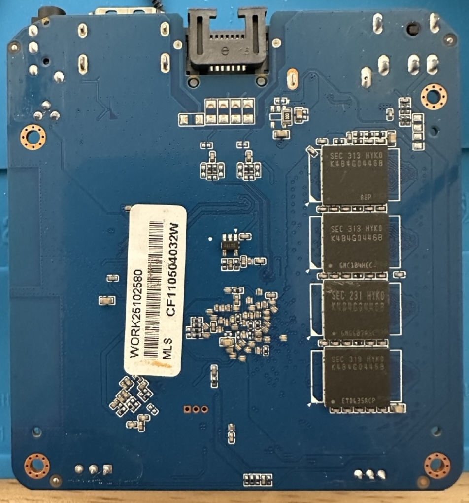
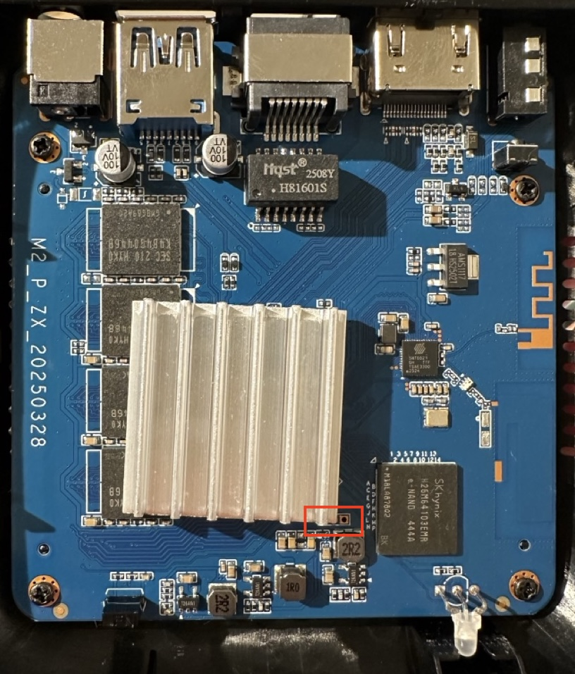
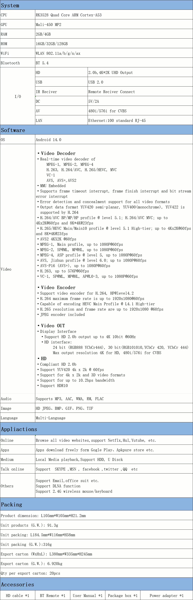

# H96 Max M2 Plus

## Identity

| Item             | Value                                   |
| ---------------- | --------------------------------------- |
| Board ID         | `h96max-m2-plus`                        |
| PCB              | `M2_P_ZX_20250328`                      |
| SoC              | RK3528; USB chip query and factory tree |
| Radio marking    | SWT6621S; photo reading                 |
| RAM marking      | 8× Samsung K4B4G0446B DDR3, 4 per side  |
| Storage marking  | SK hynix H26M64103EMR; photo reading    |
| RAM capacity     | 4 GiB fitted; 3921 MiB usable           |
| Storage capacity | 61,079,552 sectors × 512 bytes          |
| SD slot          | Not present; owner checked              |
| Ethernet PHY     | SoC-internal; `rk630phy` driver         |
| LAN magnetics    | HQST H81601S                            |
| 1.8 V LDO        | AMS1117-1.8                             |
| USB              | One USB 3.0 Type-A; 5000M on `uas`      |

Product: <https://h5.h96max.com/products-details/h96-max-m2-android-tv-box>

Store: <https://www.aliexpress.com/store/1105506642>

## Serial console

- **Location**: three plated holes near the SoC heatsink's corner, beside the LED.
- **Pinout**: **TX · GND · RX**, RX the square pad.
- **Level**: 3.3 V.
- **Console**: `ttyFIQ0`, 1500000 8N1.

## Addresses

| Interface | Address             | Source                        |
| --------- | ------------------- | ----------------------------- |
| Ethernet  | `00:ef:00:4a:5a:bf` | Stock vendor storage, LAN_MAC |
| Wi-Fi     | `fe:fd:fc:53:fe:66` | The chip; same after a reload |
| Bluetooth | `FE:FD:FC:53:FE:67` | The Wi-Fi address plus one    |

All three held across the recorded warm boots.

## Test report

Kernel: `6.1.172-tvb-rk35xx`. The unattended lines a kernel can change, again on `rk35xx-next`, are
in their own table.

### Contact

| Check            | Mark | Evidence                                     |
| ---------------- | ---- | -------------------------------------------- |
| Listing recorded | ✅   | URL, listing image, PCB photos               |
| SoC identified   | ✅   | USB chip bytes `38 32 35 33`; factory tree   |
| Kind decided     | ✅   | Board: RK3528, SWT6621S; existing mechanisms |

### Backup

| Check                   | Mark | Evidence                                                  |
| ----------------------- | ---- | --------------------------------------------------------- |
| Backup off the box      | ✅   | Full stock image saved on host                            |
| Backup size             | ✅   | 31,272,730,624 bytes; flash query matches                 |
| Backup read-back        | ✅   | Boot block, super and final GPT reread match              |
| Preserved ranges        | ✅   | Protected ranges retained and full flash readback matches |
| DRAM-init blob          | ✅   | 2 MiB; duplicate reads and recovery read match            |
| Stock recovery gestures | ✅   | Recovery button to Loader, tried on stock; Recovery below |

### Identity

| Check               | Mark | Evidence                                      |
| ------------------- | ---- | --------------------------------------------- |
| Stock log on serial | ➖   | stock not booted on serial                    |
| ID searched         | ✅   | Manufacturer model search: RK3528 M2 Plus     |
| ID confirmed        | ✅   | Owner confirmed ID                            |
| PCB photos          | 🟡   | Both sides; SoC hidden under heatsink         |
| Serial pads marked  | ✅   | TX, GND, RX (square), 3.3 V; a clean boot log |
| Components          | ✅   | Marked parts in Identity, both sides          |
| board.md sections   | ✅   | Required sections present                     |
| PCB name and date   | ✅   | Full silkscreen in board.conf                 |

### Dump

| Check                 | Mark | Evidence                                              |
| --------------------- | ---- | ----------------------------------------------------- |
| Stock files           | ➖   | Known family and chip: the factory image in `backup/` |
| Stock identity table  | ➖   | Known family and chip: no `stock/` directory          |
| Factory trees carved  | ✅   | Kernel and U-Boot blobs carved from stock             |
| Nothing private       | ➖   | No stock files committed                              |
| Decode bases          | ✅   | Vendor 6.1 / 2017.09 decode bases                     |
| Per-unit values       | ✅   | Per unit table; each read at boot                     |
| Codec matrix, keymaps | ✅   | Video engine table; keylayouts from the factory image |

### Trees

| Check                 | Mark | Evidence                                             |
| --------------------- | ---- | ---------------------------------------------------- |
| Trees and patches     | ✅   | Factory DTS and patches generated                    |
| Decompile names       | ✅   | dtcx: no unnamed cells                               |
| Changes explained     | ✅   | Tree changes explain their hardware or driver reason |
| Disabled nodes marked | ➖   | No node disabled in the board patch                  |
| IOMMU quiet at idle   | ✅   | No IOMMU interrupt in 30 s idle                      |
| dtb.md complete       | ✅   | Tree changes recorded                                |
| Suspend setup         | ✅   | Factory `deep`; `s2idle` tried, in `dtb.md`          |
| Memory node           | ✅   | Booted reg present; no linux,usable-memory           |

### Boot

| Check               | Mark | Evidence                                            |
| ------------------- | ---- | --------------------------------------------------- |
| Service-mode loader | ✅   | Factory DDR + usbplug uploaded in Maskrom           |
| mtest               | ❓   | Optional                                            |
| Boot from SD        | ➖   | No SD slot                                          |
| Boot from USB       | ❓   | Optional                                            |
| Network and ssh     | ✅   | SSH over the installed eMMC system                  |
| Loaders in image    | ✅   | Full written image readback matches preserved image |
| Installed DTB       | ✅   | Installed DTB SHA-256 matches repo artifact         |
| Firmware packaged   | ✅   | Shared SWT6621S package; board NV selector          |

### System

| Check                   | Mark | Evidence                                                     |
| ----------------------- | ---- | ------------------------------------------------------------ |
| Network, no serial      | ✅   | Up on the network every boot; no serial attached             |
| U-Boot on serial        | ✅   | Our U-Boot's menu, 1500000 8N1; `2026-11-07-serial-boot.log` |
| Kernel on serial        | ✅   | `6.1.172-tvb-rk35xx` from its first line                     |
| Login on serial         | ✅   | `h96max-m2-plus login:` on `ttyFIQ0`                         |
| Boot on HDMI            | ✅   | From the kernel's first lines; U-Boot has no display         |
| dmesg accounted         | ✅   | Every line accounted; tolerated lines below                  |
| Boot time explained     | ✅   | 5.1 s to graphical; NetworkManager 1.4 s longest             |
| Second boot time        | ✅   | 10.3 s                                                       |
| Board identity files    | ✅   | Installed ID, model and complete PCB match                   |
| Modules loaded          | ✅   | All three SWT6621S modules; AIC8800 package family-wide      |
| Ten warm reboots        | ✅   | 10 of 10, with `power-off-delay-us`                          |
| RAM size                | ✅   | 4 GiB fitted; see Measured                                   |
| RAM stress              | ✅   | 2800M VM, verify, 60 seconds; exit 0                         |
| Watchdog timeout        | ✅   | 24 MHz clock; journal grants 89 seconds                      |
| Watchdog fires          | ✅   | Set 10 s, granted 11 s; reset at it, not 89 s                |
| Panic reboots           | ✅   | SysRq panic rebooted; dmesg-ramoops archived                 |
| No userspace setup      | ✅   | Packages ship one rfkill rule, one module option             |
| Lean image              | ✅   | Image list only; bring-up tools added by hand                |
| CPU OPP table           | ✅   | All nine factory CPU OPPs exposed                            |
| CPU stress, no throttle | ✅   | Five-minute four-core verify; no throttling                  |
| Combined soak           | 🟠   | 30 min, 103 °C; no eMMC, RAM, Wi-Fi error; one Lima fault    |
| Lockup recovery         | ✅   | Lockups panic, reboot, keep records                          |

### Video

| Check                | Mark | Evidence                                                  |
| -------------------- | ---- | --------------------------------------------------------- |
| Decode matrix        | 🟠   | Reachable codecs at vendor sizes; VC-1, AVS, MVC not      |
| Encode decodes back  | ✅   | H.264, HEVC decode back, 40–46 dB                         |
| Decoder downscale    | ✅   | H.264, HEVC shrink by ½                                   |
| 4K film plays smooth | ✅   | Owner: 4K HEVC 10-bit with its audio, smooth in a player  |
| AFBC to the plane    | ✅   | HEVC 8- and 10-bit at 4K: every picture AFBC on the plane |
| Scaled to the plane  | ❓   | Its test is a todo                                        |
| Past each limit      | ✅   | 16K: no frames, an error; next decode right               |
| Matrix recorded      | ✅   | Video engine below; RK3528 column                         |

### Display

| Check                      | Mark | Evidence                                                 |
| -------------------------- | ---- | -------------------------------------------------------- |
| TV at 4K60                 | ❓   | —                                                        |
| Every mode, TV and monitor | ❓   | Optional                                                 |
| HDMI hotplug               | ✅   | Plugged in running: native mode set, console back        |
| HDR transitions            | ✅   | SDR, PQ, HLG at 8 and 10 bpc; InfoFrames read back       |
| Refresh follows content    | ❓   | Optional                                                 |
| Sound cards timed          | ✅   | HDMI, codec, S/PDIF: 3 s in 3.03–3.16 s, 44.1 and 48 kHz |
| HDMI audio heard           | ✅   | Heard over HDMI, the default sink                        |
| Multichannel LPCM          | ❓   | Optional                                                 |
| AC3, DTS passthrough       | ❓   | Optional                                                 |
| CEC address                | ✅   | `cec-ctl`: physical address 1.0.0.0                      |
| TV remote over CEC         | ❓   | —                                                        |
| DDC/CI read                | ✅   | `i2c-gpio` DDC: `ddcutil` finds MCCS 2.2                 |
| DDC/CI write               | ✅   | Brightness 100 to 80 and back, read back                 |
| S/PDIF heard               | ➖   | No S/PDIF connector on the PCB                           |
| AV out                     | ❓   | Optional                                                 |
| GPU on screen              | ✅   | glmark2 43 at 1080p; `terrain` unsupported               |
| Console font               | ✅   | Owner read the console at 2256x1504, 16×32 font          |
| Planes listed              | ✅   | Planes 59, 75, 124: formats, alpha, zpos 0–5             |
| Composition, underruns     | ✅   | Composed by writeback; 4K60 with no underrun             |
| Colour stages              | ✅   | SDR to PQ and HLG within one code; no LUT stage          |
| Commit pacing              | ✅   | 3600 commits in 60 s, none refused                       |
| SDR over HDR scope         | ✅   | SDR to PQ maps the whole output                          |
| Unmapped recorded          | ✅   | HDR10, HLG to SDR and HLG to PQ left to the GPU          |
| HDR sinks                  | ✅   | HDR sent for exactly the EOTFs each screen lists         |
| Display rating             | ✅   | Largest 4K60, fastest 1080p120; Display below            |

### Power

| Check               | Mark | Evidence                                                |
| ------------------- | ---- | ------------------------------------------------------- |
| Sleep and wake      | ✅   | Power key sleeps and wakes, over BLE and IR             |
| Off and on          | ✅   | 5 s hold over BLE powers off; a short press boots       |
| Wake reliable       | ✅   | Ten of ten wakes in `deep`; devices back each time      |
| No double-fire      | ✅   | Waking press not re-acted on; the box stays up          |
| s2idle              | ➖   | Has `deep`; `s2idle` tried: nothing wakes it            |
| Deep sleep          | ✅   | `deep`, woken by the remote; same `boot_id`             |
| Sleep past watchdog | ✅   | 153 s in `deep`, past the 89 s watchdog: same `boot_id` |
| RTC                 | ✅   | No RTC device; time from NTP                            |
| Power draw in sleep | ✅   | 1.3 W idle, 0.7 W in `deep`                             |

### Storage

| Check                    | Mark | Evidence                                                |
| ------------------------ | ---- | ------------------------------------------------------- |
| eMMC under fio           | ✅   | Four fio modes and checksum verification pass           |
| SD under fio             | ➖   | No SD slot                                              |
| SD hotplug               | ➖   | No SD slot                                              |
| Speed modes survive      | ✅   | HS200 100 MHz survives ten warm boots                   |
| tvb-install              | ➖   | Installed over the service mode; USB boot optional      |
| eMMC boot                | ✅   | eMMC boots with prepared board FIT and factory DDR init |
| Per-unit window kept     | ✅   | Every protected range matches stock backup              |
| Service mode, our U-Boot | ✅   | Recovery button under our U-Boot: Loader                |
| Loader, eMMC size        | ✅   | Board loader; flash query 61,079,552 sectors            |
| Write reads back         | ✅   | Image written over it, read back identical; it boots    |

### Network

| Check                | Mark | Evidence                                                   |
| -------------------- | ---- | ---------------------------------------------------------- |
| Ethernet speeds      | ✅   | 10 Mbit/s 9.29 / 9.30; 100 Mbit/s 93.5 / 94.1              |
| Ethernet idle        | ✅   | 100 Mbit/s Ethernet; three-run idle median                 |
| Ethernet under load  | ✅   | 93.2 / 94.0 Mbit/s under 4-core and eMMC load              |
| Ethernet PHY driver  | ✅   | RK630 PHY, not Generic                                     |
| Wi-Fi bands          | ✅   | 2.4 and 5 GHz, domain 00; Measured below                   |
| Wi-Fi idle           | ✅   | 5 GHz throughput; three-run idle medians                   |
| Wi-Fi under load     | ✅   | 208.5 / 215.1 Mbit/s under 4-core and eMMC load            |
| Hours of traffic     | ❌   | 2 h, no drop; then Wi-Fi connects stall until reboot       |
| Scan, no region      | ✅   | Scan completes in world domain 00                          |
| Region set           | ✅   | Global and self-managed PHY accept US, then 00             |
| Bluetooth up         | ✅   | UP RUNNING; RX/TX errors 0                                 |
| Bluetooth scan       | ✅   | Bounded discovery found LE and BR/EDR devices              |
| Remote pairs, stays  | ✅   | Paired by `tvb-pair-remote`; reconnected after a power-off |
| BLE wake             | ❌   | No BLE wake: `wake event 0x0`; wakes over IR               |
| Addresses stable     | 🟡   | Same over reboots and power-off; reinstall open            |
| Addresses the unit's | ✅   | LAN from vendor storage; Wi-Fi held over a module reload   |
| Per-unit firmware    | ✅   | Board NV file loaded by its board name                     |
| Access point         | ➖   | Once a chip: the SWT6621S page                             |
| Wi-Fi Direct         | ➖   | Once a chip: the SWT6621S page                             |
| Wi-Fi modes vs stock | ➖   | Once a chip: the SWT6621S page                             |

### Input

| Check                 | Mark | Evidence                                               |
| --------------------- | ---- | ------------------------------------------------------ |
| USB topology          | ✅   | Root hubs only; no hub between port and controller     |
| USB 3                 | ✅   | Lexar USB 3.2 at 5000M on `uas`                        |
| USB 2                 | ✅   | PNY USB 2.0 at 480M; Lexar in at power-on enumerates   |
| USB under load        | ✅   | 4-core load: 291 MiB/s read, 199 write, verified       |
| USB hotplug           | ✅   | Unplugged and back: SuperSpeed, `uas`, partitions read |
| USB 1.1               | ✅   | Logitech receiver at 12M, four HID inputs              |
| IR table              | ✅   | `ir_key6`, `0xfb04`: every button canonical            |
| IR keymap             | ✅   | Every button pressed over IR: the canonical keymap     |
| BLE keymap            | ✅   | 20 keys canonical, on `bt-remote`; power, mouse open   |
| Remote boots from off | ✅   | A short press starts the box from off: new `boot_id`   |
| Buttons register      | ✅   | The one button, in the AV jack: an input, `adc-keys`   |
| Recovery to service   | ✅   | Owner: the recovery button enters the service mode     |
| Input names           | ✅   | Five event nodes, each linked; `cec-powerkey` added    |
| Recovery KEY_VENDOR   | ✅   | AV-jack recovery button: `KEY_VENDOR` under `evtest`   |
| LED on                | ✅   | Running: blue (`power`); red and green while booting   |
| LED off               | ✅   | Powered off: red (`standby`)                           |
| LED asleep            | ✅   | Asleep: red (`standby`), blue off; blue again on wake  |

### Finish

| Check           | Mark | Evidence                                          |
| --------------- | ---- | ------------------------------------------------- |
| No line open    | ❓   | —                                                 |
| Gaps scoped     | ❓   | —                                                 |
| Daily use       | ❓   | —                                                 |
| READMEs list it | ✅   | README and README_ROCKCHIP list the board         |
| CI green        | 🟡   | Local `./build.sh test`: 62 pass; CI runs on push |
| Untested named  | ❓   | —                                                 |
| Steering closed | ❓   | —                                                 |

### On `rk35xx-next`

`6.12.69-tvb-rk35xx`; Same is the same result as on 6.1.

| Check                   | Mark | Differs                                             |
| ----------------------- | ---- | --------------------------------------------------- |
| Network, no serial      | ✅   | Same                                                |
| dmesg accounted         | ✅   | Same                                                |
| Boot time explained     | ✅   | Same                                                |
| Second boot time        | ✅   | 11.0 s                                              |
| Modules loaded          | ✅   | Same                                                |
| Ten warm reboots        | ✅   | 20 of 20 with `power-off-delay-us`, 9 of 20 without |
| RAM stress              | ✅   | Same                                                |
| Watchdog timeout        | ✅   | Same                                                |
| Watchdog fires          | ✅   | Same                                                |
| Panic reboots           | ✅   | Same                                                |
| CPU OPP table           | ✅   | Same                                                |
| CPU stress, no throttle | ✅   | Same                                                |
| Combined soak           | ❓   | —                                                   |
| Lockup recovery         | ✅   | Same                                                |
| Decode matrix           | 🟠   | Same                                                |
| Encode decodes back     | ✅   | Same                                                |
| Decoder downscale       | ✅   | Same                                                |
| Past each limit         | ✅   | Same                                                |
| HDR transitions         | ✅   | Same                                                |
| Sound cards timed       | ✅   | Same                                                |
| CEC address             | ✅   | Same                                                |
| DDC/CI read             | ❓   | —                                                   |
| DDC/CI write            | ❓   | —                                                   |
| GPU on screen           | ✅   | glmark2 50 at 1080p                                 |
| Planes listed           | ✅   | Same                                                |
| Composition, underruns  | ✅   | Same                                                |
| Colour stages           | ✅   | Same                                                |
| Commit pacing           | ✅   | Same                                                |
| SDR over HDR scope      | ✅   | Same                                                |
| HDR sinks               | ✅   | Same                                                |
| Display rating          | ✅   | Same                                                |
| eMMC under fio          | ✅   | Same                                                |
| Speed modes survive     | ✅   | Same                                                |
| Ethernet idle           | ✅   | Same                                                |
| Ethernet under load     | ✅   | Same                                                |
| Ethernet PHY driver     | ✅   | Same                                                |
| Wi-Fi bands             | ✅   | Same                                                |
| Wi-Fi idle              | ✅   | Same                                                |
| Wi-Fi under load        | ✅   | Same                                                |
| Hours of traffic        | ❓   | —                                                   |
| Scan, no region         | ✅   | Same                                                |
| Region set              | ✅   | Same                                                |
| Bluetooth up            | ✅   | Same                                                |
| Bluetooth scan          | ✅   | Same                                                |
| Addresses stable        | 🟡   | Same                                                |
| Addresses the unit's    | ✅   | Same                                                |
| USB topology            | ✅   | Same                                                |
| Input names             | ✅   | Same                                                |

## Measured

2026-11-05, kernel `6.1.172-tvb-rk35xx`, factory heatsink.

| What                         | Result                                     |
| ---------------------------- | ------------------------------------------ |
| eMMC user area               | 31,272,730,624 bytes; USB flash query      |
| Usable RAM                   | 3921 MiB                                   |
| First boot                   | 11.453 s; kernel + userspace               |
| Second boot                  | 10.336 s; kernel + userspace               |
| RAM verification             | 2800M, 60 s; no failures                   |
| CPU stress peak              | 71.352 °C; 300 s at 2.016 GHz              |
| Thermal trips                | 95 / 110 / 120 °C                          |
| eMMC sequential write / read | 79.85 / 92.10 MB/s                         |
| eMMC 4K random write / read  | 3218 / 6619 IOPS                           |
| eMMC checksum verify         | 256 MiB, CRC32C; clean                     |
| Ethernet upload / download   | 93.50 / 94.10 Mbit/s; median of three      |
| 5 GHz upload / download      | 208.18 / 204.71 Mbit/s; median of three    |
| 2.4 GHz upload / download    | 131.4 / 168.1 Mbit/s; median of three      |
| Under 4-core and eMMC load   | Ethernet 93.2 / 94.0; 5 GHz 208.5 / 215.1  |
| Combined soak, 30 min        | Peak 105.0 °C; CPU 2016 MHz throughout     |
| CMA, peak under 8K decode    | 3.0 MiB of 16 MiB                          |
| Draw, idle after boot        | 1.3 W                                      |
| Draw, in `deep`              | 0.7 W                                      |
| USB 3 stick, 4-core load     | Read 291 MiB/s, write 199 MiB/s, 2982 IOPS |

Throughput: three eight-second runs per direction, bound to each interface; idle CPU, 40 MHz HE
link.

| What                    | Result                              |
| ----------------------- | ----------------------------------- |
| Warm boots              | Ten recorded; all addresses held    |
| Automated boot recovery | 25.7–35.1 s, cycles two through ten |

## Tolerated boot lines

| Line                                             | Why                                          |
| ------------------------------------------------ | -------------------------------------------- |
| `Reserved memory: failed ... drm-logo`           | Factory U-Boot logo nodes; size 0            |
| `fiq_debugger ... IRQ fiq not found`             | SoC; sisters print it                        |
| `Looking up *-supply ... failed`                 | Supplies the tree omits; dummy used          |
| `SCMI protocol 17/22 not active`                 | Firmware lacks them; sisters print it        |
| `vop2_bind ... INVALID`, `failed to init ...`    | Vendor VOP2 on RK3528; sisters print it      |
| `Cannot find any crtc or sizes`                  | No HDMI sink at boot                         |
| `rkvdec2_init ... clk_get`, `shared_* not found` | Vendor MPP on RK3528; sisters print it       |
| `rkvenc ... opp`, `rockchip-dmc ... vop`         | Vendor devfreq; sisters print it             |
| `optee: probe ... -22`                           | Sisters print it                             |
| `Can't reduce the clock below 52MHz`             | HS200 retune; sisters print it               |
| `usb usb2-port1: config error`                   | USB 3 port's root port; see Known gaps       |
| `gpu-bus ... pvtm`                               | See Known gaps                               |
| `orphan cleanup on readonly fs`                  | After a watchdog or lockup reset             |
| `skw firmware: board firmware ... not found`     | Per-board firmware absent; generic loaded    |
| `chipen=106 ... ret = -16`                       | Driver re-requests its own GPIO; sisters too |
| `SKW_CMD_GET_STA expect len`                     | Firmware's short station reply               |
| `Failed to read local supported codecs`          | Codec reads answered locally by design       |
| `mtd_vendor_storage: deferred probe pending`     | No MTD device; sisters print it              |
| 6.12: `failed to init cpufreq`                   | Deferred until SCMI's clock is up            |
| 6.12: `IRQ eth_lpi`, `IRQ sfty not found`        | Optional stmmac interrupts                   |
| 6.12: `Unable to detect cache hierarchy`         | No cache nodes in the tree                   |
| 6.12: `failed to set PD rpm always on`           | eMMC node has no power domain                |

## Video engine

The vendor's listing against `tools/validate/video.py`, `rkmpp`, on `6.1.172-tvb-rk35xx`,
2026-11-06: the largest size passing, and fps of the engine alone at 3840×2160 or the largest.

| Codec            | Vendor             | Measured          | fps |
| ---------------- | ------------------ | ----------------- | --- |
| H.264 8-bit      | L5.1, 4K60, 8K23   | ✅ 8192×8192      | 62  |
| H.264 10-bit     | —                  | ✅ 8192×8192      | 55  |
| HEVC Main/Main10 | L5.1, 4K60, 8K23   | ✅ 8192×8192      | 116 |
| VP9              | —                  | ➖ MPP refuses    | —   |
| VP8              | —                  | ✅ 1920×1080      | 59  |
| MPEG-1, MPEG-2   | 1080p60            | ✅ 1920×1080      | 70  |
| MPEG-4           | ASP L5, 1080p60    | ✅ 1920×1080      | 77  |
| H.263            | 576p60             | ✅ 1408×1152      | 79  |
| VC-1             | AP L3, 1080p60     | ❓ no FFmpeg path | —   |
| AVS, AVS+, AVS2  | 1080p60; AVS2 4K60 | ❓ no FFmpeg path | —   |
| MVC              | listed             | ❓ 2D only, todo  | —   |
| H.264 encode     | HP L4.2, 1080p60   | ✅ 8192×8192      | 53  |
| HEVC encode      | Main L4.1, 1080p60 | 🟠 8192×8192      | 60  |

Encode fps are at 1920×1080. The decoder shrinks H.264 and HEVC by ½. HEVC encode at 7680×4320
differs run to run. Past each limit the stream is refused or decodes to no frames with an error; the
next decode is right.

## Display

`tools/validate/display.py` headless, connector forced off, synthetic HDMI 2.0 screen:

| Mode         | Result                                       |
| ------------ | -------------------------------------------- |
| Sustained    | 4K60, 4K30, 4K24, 1080p120/60/24, 720p120/60 |
| Pruned       | 8K60, 8K30, 4K120                            |
| Native, real | 2256x1504p60, 235.7 MHz                      |

With a real screen that takes YCbCr, the writeback refuses YCbCr output
(`YUV2RGB is not supported by writeback`): run the suite with the connector off.

## Per unit

| Value     | This unit               | Detected by                     |
| --------- | ----------------------- | ------------------------------- |
| RAM       | 4 GiB                   | DDR init; U-Boot writes `reg`   |
| eMMC mode | HS200, 100 MHz          | Kernel negotiates with the card |
| CPU bin   | bin 0, PVTM 1370, sel 2 | Vendor cpufreq, eFuse and PVTM  |

## Runtime

- eMMC: HS200, 100 MHz, 8-bit, 1.8 V.
- CPU: 408, 600, 816, 1008, 1200, 1416, 1608, 1800 and 2016 MHz.
- Ethernet: 100 Mbit/s full duplex.
- Wi-Fi: 5 GHz, channel 40, 40 MHz, country `00`.
- Bluetooth: HCI 5.3; codec capability reads bypassed by the packaged driver option.

## Known gaps

- Untested, waiting on a person: a TV at 4K60; the scaled picture to a plane waits on our test.
- DDR pinned at 786 MHz by the factory's `auto-freq-en = <0>`; load-based scaling hung the box.
- AVS, AVS2: MPP decodes them; our FFmpeg has no `rkmpp` path. VC-1: no decoder in MPP. MVC: the 2D
  base view only, a todo.
- Wi-Fi: the station-info reply is short (`SKW_CMD_GET_STA`), a driver warning.
- BLE wake: none, as on every board (`docs/todo/README.md`); the remote wakes the box over IR.
- Wi-Fi after resume: `SKW_CMD_RESUME` gets no reply; 3.9 Mbit/s at once, 44 a minute on, full
  after. Recovers by itself.
- Wi-Fi: after 2 h of traffic, about half the TCP connects over it stalled; reassociation and a
  driver reload kept it, a reboot cleared it. Seen once.
- Heat: a 30-minute combined soak holds 100–105 °C at full clock; the zone, Rockchip's own design,
  throttles at 110 °C. One Lima MMU fault came at 103 °C, in one of three soaks.
- USB 3 port: with nothing plugged, its root port logs `config error`.
- `gpu-bus` fails to probe (no `pvtm` regulator): `vdd_logic` does not follow the GPU clock. The DMC
  floor is 850 mV; the GPU bus wants up to 875 mV at 800 MHz. Read 900 mV at idle.

## Recovery

With DC disconnected, hold the PCB recovery button, connect the Mac to USB-A over OTG, then release
after five seconds: factory Loader. `rkdeveloptool rd 3` enters Maskrom; the board-specific
`maskrom_loader.bin` uploads successfully and reads its boot block back unchanged. Stock access was
verified before installation.

Full stock backup saved; boot block, super header and final GPT sectors match independent USB reads.
Recovery-button entry after replacing U-Boot is untested on this board.
