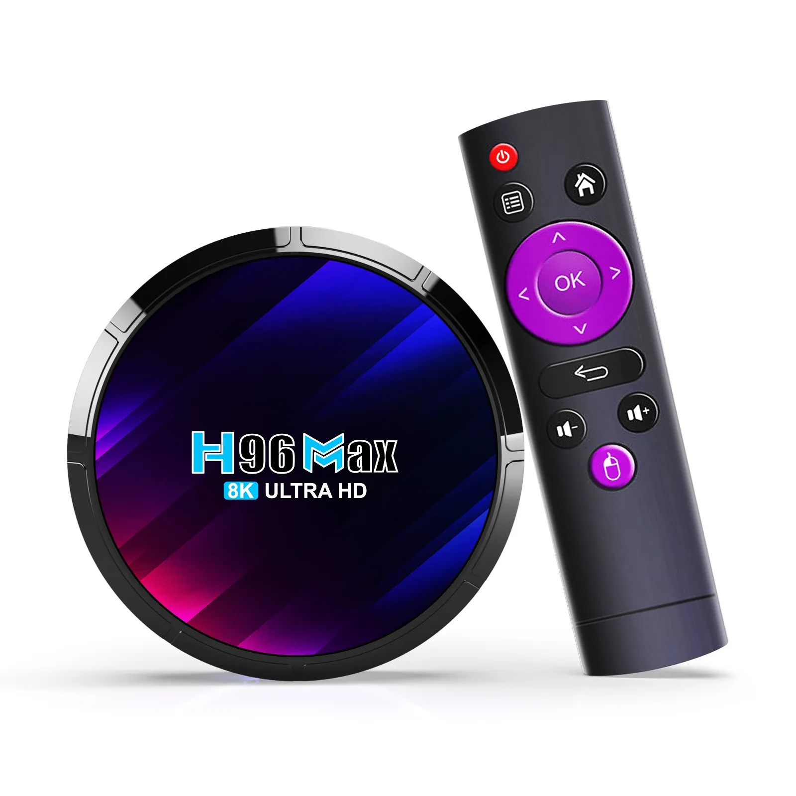
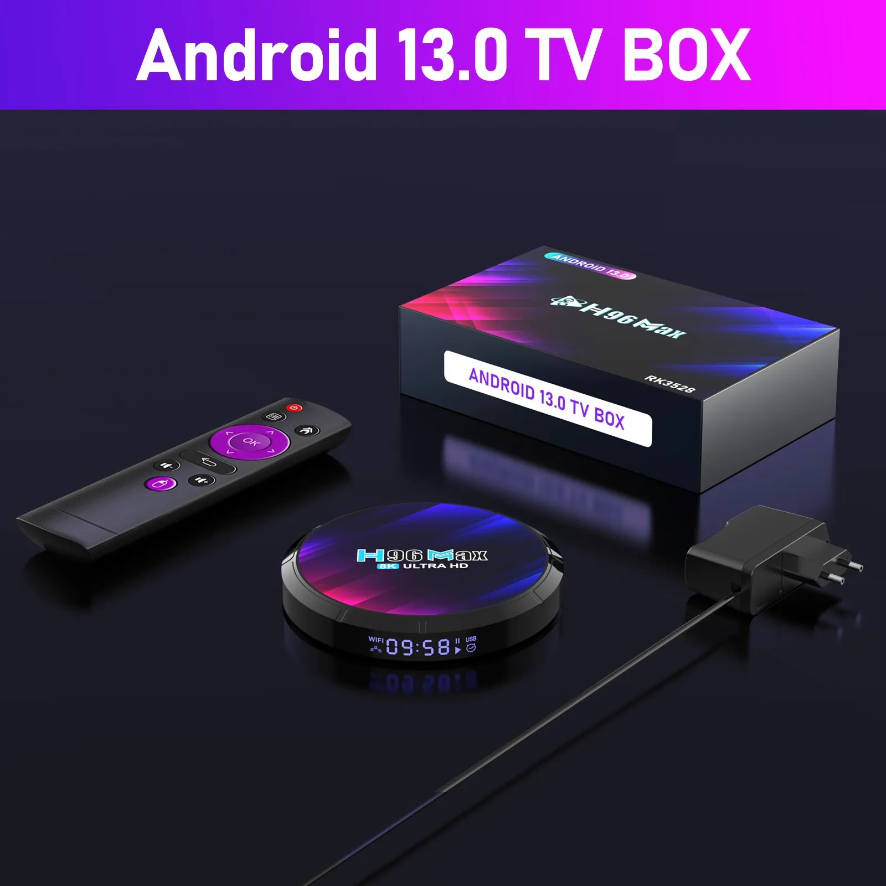
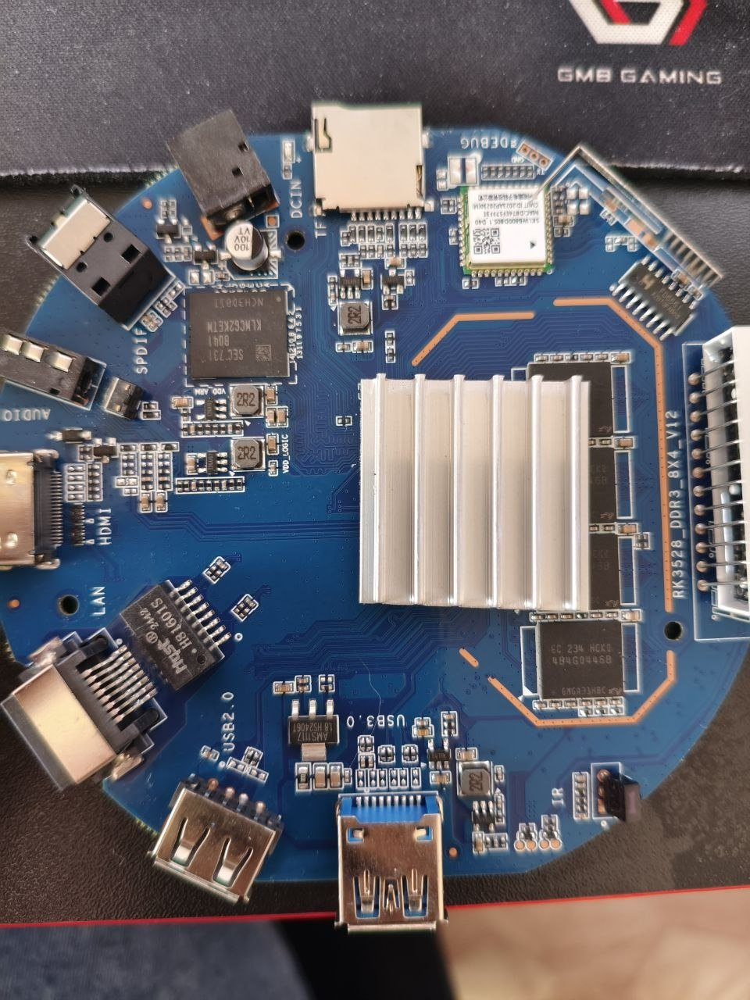
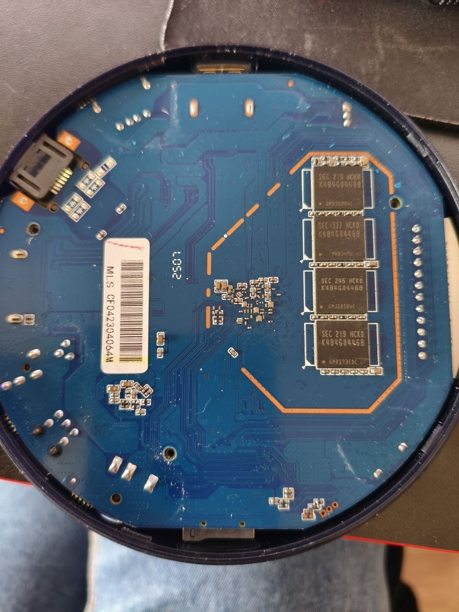

# H96 Max RK3528

> **Not tested here.** Imported from the box's stock firmware image: no box has run TVBian here.
> Every mark below rests on the image, an owner's photos and stock boot log, or a sister board that
> proves the same block. Ran it? Tell us in an issue.

## Identity

| Item          | Value                                                             |
| ------------- | ----------------------------------------------------------------- |
| Board ID      | `h96max-rk3528`                                                   |
| PCB           | `RK3528_DDR3_8X4_V12`; no date on the silkscreen                  |
| SoC           | RK3528; factory tree, stock package chip `3528`                   |
| RAM marking   | 8× Samsung K4B4G0446B DDR3, 4 per side; an owner's photos         |
| Storage       | Samsung `KLMCG2KETM-B041`, 64 GB; an owner's unit                 |
| Radio         | AIC8800D80, rev 7, sub-ID 2, on SDIO; Bluetooth on `uart2`        |
| Radio marking | `SKYWB8800 / SG-WB800E` by its owner; the photo reads `WB8800D80` |
| Ethernet      | 10/100, the SoC's internal PHY; H81601S magnetics                 |
| Ports         | HDMI, USB-A 3.0, USB-A 2.0, LAN, microSD, AV, SPDIF, IR, DC 5 V   |
| Buttons       | Recovery, behind the AV jack                                      |
| Front panel   | A clock LCD on an FD655 driver; no LEDs                           |
| Case          | Round                                                             |
| Stock         | Android 13; the import's image `H96 Max RK3528 20230630.1201`     |
| Import        | BOXPUT's firmware page, 2026-11-07                                |

Product: <https://h5.h96max.com/products-details/h96-max-rk3528-android-13-8k-uhd-tv-box>

## Sources

| Source                     | Holds                                             |
| -------------------------- | ------------------------------------------------- |
| [Armbian forum 59122][arm] | two owners' boards: photos, parts, boot notes     |
| [Daninet's repo][dan]      | this board's carved stock tree and stock boot log |
| [BOXPUT's firmware][box]   | the stock image this import is built from         |

[arm]: https://forum.armbian.com/topic/59122-h96-max-rk3528-cannot-boot-armbian-from-tfsd-card/
[dan]: https://github.com/Daninet/rk3528-h96max-armbian
[box]: https://boxput.notion.site/H96-Series-Frieware-b314bb2353ba4f08979edfca10db54fe

## Serial console

- **Location**: three holes marked `DEBUG`, beside the microSD slot.
- **Pinout**: ❓.
- **Console**: `ttyFIQ0`, 1500000 8N1, as stock's `/chosen` sets it.

## Test report

Imported, not run. Sisters by block: the H96 Max M2 Plus, an RK3528, for the SoC's blocks; the R69-1
for the AIC8800D80 at the same revision and sub-ID.

### Contact

| Check            | Mark | Evidence                                             |
| ---------------- | ---- | ---------------------------------------------------- |
| Listing recorded | ✅   | H96's product page; its box and contents photos      |
| SoC identified   | ✅   | Factory tree `rockchip,rk3528`; the package's `3528` |
| Kind decided     | ✅   | Import: `rk35xx`, AIC8800D80, both in the repo       |
| Serial boot log  | ❓   | No box; an owner's stock log is the only one         |

### Backup

| Check                   | Mark | Evidence                                                |
| ----------------------- | ---- | ------------------------------------------------------- |
| Backup off the box      | ❓   | No box                                                  |
| Backup size             | ❓   | No box                                                  |
| Backup read-back        | ❓   | No box                                                  |
| Preserved ranges        | 🟡   | The family's `preserve-sectors.rk35xx`, as every RK3528 |
| DRAM-init blob          | ✅   | From the image's loader; the owner's boot log prints it |
| Stock recovery gestures | ❓   | The button exists; never tried                          |

### Identity

| Check          | Mark | Evidence                                             |
| -------------- | ---- | ---------------------------------------------------- |
| ID searched    | ✅   | H96's page; forum thread 59122                       |
| ID confirmed   | ✅   | By the human, the photos against H96's page          |
| PCB photos     | ✅   | `board-top.jpg`, `board-bottom.jpg`, an owner's      |
| Serial pads    | ❓   | Located, pins unnamed                                |
| Components     | 🟡   | RAM and eMMC read; the radio module's marking unsure |
| Doc sections   | ✅   | Every section this import can fill                   |
| PCB name, date | ✅   | `RK3528_DDR3_8X4_V12`; no date printed               |

### Dump

| Check                    | Mark | Evidence                                              |
| ------------------------ | ---- | ----------------------------------------------------- |
| Factory trees carved     | ✅   | `boot.img`'s `rk-kernel.dtb`; `uboot.img`'s FIT `fdt` |
| Nothing kept out in repo | ✅   | No per-unit data: the image carries none              |
| Bases named              | ✅   | Vendor 6.1 kernel, vendor U-Boot 2017.09              |
| Per-unit values          | ❓   | No unit                                               |
| Codec matrix, IR keymaps | 🟡   | Keymaps recorded; H96 lists no codec matrix           |

### Trees

| Check                  | Mark | Evidence                                              |
| ---------------------- | ---- | ----------------------------------------------------- |
| Factory trees, patches | ✅   | `factory_board.dts`, `board.patch`; U-Boot's likewise |
| Decompile named        | ✅   | 301 and 35 cells named, none left as numbers          |
| Changes justified      | ✅   | Each the factory's, or commented; `dtb.md`            |
| Disabled nodes marked  | ✅   | None disabled                                         |
| IOMMU quiet at idle    | ❓   | Not run                                               |
| `dtb.md` complete      | ✅   | Every change                                          |
| Suspend setup measured | ❓   | Not run                                               |
| Memory node            | ❓   | Not run                                               |

### Boot

| Check                           | Mark | Evidence                                               |
| ------------------------------- | ---- | ------------------------------------------------------ |
| Service-mode loader, bare       | ❓   | Built from the board's DDR init; not run               |
| `mtest` over RAM                | ❓   | Not run                                                |
| Boots from microSD              | ❓   | Not run                                                |
| Boots from a USB stick          | ❓   | Not run                                                |
| Network and `ssh`               | ❓   | Not run                                                |
| Loaders at sectors 64 and 16384 | ✅   | The image's: the stock idblock, our U-Boot             |
| `board.dtb` installed as built  | ✅   | Byte-identical in the built image                      |
| Firmware packaged               | ✅   | `tvb-firmware-aic8800`; its calibration equals stock's |

### System

| Check                           | Mark | Evidence                                                 |
| ------------------------------- | ---- | -------------------------------------------------------- |
| Network with no serial          | ❓   | Not run                                                  |
| U-Boot, kernel, login on serial | ❓   | Not run                                                  |
| Boot on HDMI                    | ❓   | Not run                                                  |
| `dmesg` accounted for           | ❓   | Not run                                                  |
| Boot time explained, repeated   | ❓   | Not run                                                  |
| `board-{id,name,pcb}`           | ✅   | `h96max-rk3528`, `H96 Max RK3528`, `RK3528_DDR3_8X4_V12` |
| Modules loaded                  | ❓   | Not run                                                  |
| Ten warm reboots                | ❓   | Not run                                                  |
| RAM: size, `stress-ng --vm`     | ❓   | Not run                                                  |
| Watchdog: timeout, reset, panic | 🟡   | The M2 Plus's, the same SoC and node                     |
| No address or attach services   | ❓   | Not run                                                  |
| Image adds nothing extra        | ❓   | Not read from the built image yet                        |
| Factory OPP table               | ❓   | Not run                                                  |
| Heat under load, soak           | ❓   | Not run; a round case, its own heat                      |
| Lockup panic and recovery       | 🟡   | The M2 Plus's, the same SoC                              |

### Video

| Check                           | Mark | Evidence                                |
| ------------------------------- | ---- | --------------------------------------- |
| Decode per codec, largest size  | ❓   | The M2 Plus's is 🟠: VC-1, AVS, MVC not |
| Encoders round-trip             | 🟡   | The M2 Plus's                           |
| Decoder downscale               | 🟡   | The M2 Plus's                           |
| A 4K film plays                 | ❓   | Not run                                 |
| AFBC and scaled frames to plane | ❓   | Not run                                 |
| Past-limit clips                | 🟡   | The M2 Plus's                           |
| Codec matrix recorded           | 🟡   | The RK3528's, the M2 Plus's             |

### Display

| Check                       | Mark | Evidence                                    |
| --------------------------- | ---- | ------------------------------------------- |
| HDMI at the largest mode    | ❓   | Not run                                     |
| HDMI audio                  | 🟡   | The M2 Plus's, the same HDMI node           |
| CEC, DDC/CI                 | ❓   | Not run; the DDC bus is the M2 Plus's graft |
| AV jack, SPDIF              | ❓   | Not run                                     |
| GPU under lima              | 🟡   | The M2 Plus's, the same GPU node            |
| Planes, colour, pacing, HDR | ❓   | Not run                                     |
| Front clock LCD             | ❌   | FD655: no driver packaged, so dark          |

### Power

| Check                   | Mark | Evidence                          |
| ----------------------- | ---- | --------------------------------- |
| Sleep and wake          | ❓   | Not run; IR is a PSCI wake source |
| `s2idle` or deep        | ❓   | Not run                           |
| Watchdog across suspend | ❓   | Not run                           |
| RTC                     | ❓   | Not run                           |

### Storage

| Check                        | Mark | Evidence |
| ---------------------------- | ---- | -------- |
| eMMC and microSD under `fio` | ❓   | Not run  |
| microSD hotplug              | ❓   | Not run  |
| `tvb-install` to eMMC, boots | ❓   | Not run  |
| Per-unit window preserved    | ❓   | Not run  |
| Service mode on our U-Boot   | ❓   | Not run  |

### Network

| Check                        | Mark | Evidence                                             |
| ---------------------------- | ---- | ---------------------------------------------------- |
| Ethernet speeds and rate     | 🟡   | The M2 Plus's internal PHY, the same `gmac0`         |
| Wi-Fi bands and throughput   | 🟡   | The R69-1's AIC8800D80, the same revision and driver |
| Bluetooth up, scans          | 🟡   | The R69-1's, on `uart2` as stock runs it             |
| Remote pairs over Bluetooth  | ❓   | Not run                                              |
| Addresses stable, the unit's | ❓   | Not run                                              |
| Per-unit firmware named      | ✅   | Calibration equal to stock's in every enabled value  |
| AP mode, Wi-Fi Direct, modes | ❓   | Not run                                              |

### Input

| Check                  | Mark | Evidence                                             |
| ---------------------- | ---- | ---------------------------------------------------- |
| USB 3.0 and 2.0 ports  | ❓   | Not run                                              |
| Bundled remote over IR | ❓   | Six remotes in the factory tree; which is bundled ❓ |
| Recovery button        | ❓   | `KEY_VENDOR` from the factory's ADC key; not run     |
| Input device names     | 🟡   | `base/input-names.rules`, every board                |
| LEDs                   | ➖   | None on the board; the clock LCD instead             |

## Known gaps

- Nothing here has run on the box: every ❓ above.
- The front clock LCD stays dark: no FD655 driver packaged. [tm16xx-display][tm16xx], an out-of-tree
  driver that lists the FD655, can make it work (`docs/todo/README.md`).
- The bundled remote's codes are unknown: the factory's six key tables ship unmapped.
- The U-Boot tree is the M2 Plus's conversion on this board's factory tree: never run.
- Gigabit Ethernet is an option on H96's listing; this PCB and its image carry 100 Mbit.
- The image is older than this board's own stock: its radio driver and calibration are from 2023,
  the board's from 2024.

[tm16xx]: https://github.com/jefflessard/tm16xx-display
