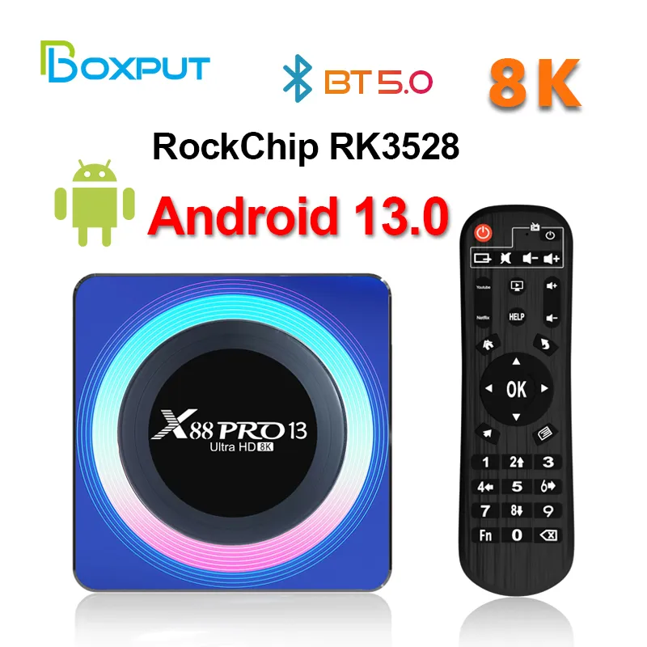

# X88 Pro 13

| Item            | Evidence                                                                                                        |
| --------------- | --------------------------------------------------------------------------------------------------------------- |
| SoC             | RK3528, stock kernel DTB `rockchip,rk3528-hugsun-x88pro-ddr4-v10`                                               |
| Stock reference | [Boxput Black 2025-03-06 RKFW](https://boxput.notion.site/X88-Series-Fireware-6f707e5e9b06413aac2df3dc291e67aa) |
| PCB             | ❓ Stock reference's silkscreen                                                                                 |
| DRAM            | Samsung K4B2G0446D-HCK0 DDR3 on the photographed V1.1 and V1.5 boards                                           |
| DRAM loader     | DDR V1.04, identical entry in six Boxput images and the eMMC bootloader capture                                 |
| Wireless        | AIC8800 and Seekwave stacks in stock, module population varies                                                  |
| Serial          | UART0, 1,500,000 baud in the stock kernel's FIQ debugger                                                        |

[Product photo source](https://tvpao.com/how-to-connect-wireless-mouse-to-android-tv-box/).

## Test report

| Check                                  | State | Evidence                                                             |
| -------------------------------------- | ----- | -------------------------------------------------------------------- |
| Stock kernel and U-Boot trees          | ✅    | Both decompile and round-trip with the RK3528 bases                  |
| 6.1 and mainline 7.3 trees             | ✅    | Both build and pass the phandle and upstream-view equivalence checks |
| U-Boot FIT and MaskROM loader          | ✅    | U-Boot 2026.10 and RK3528 new-IDB loader build on the host           |
| Board package                          | ✅    | `tvb-x88-pro-13_0~local_arm64.deb`                                   |
| SD image                               | ✅    | GPT, loader slots, ext4 and packaged DTB verified on the host        |
| Hardware boot, recovery and install    | ❓    |                                                                      |
| RAM, eMMC, SD and USB                  | ❓    |                                                                      |
| Ethernet, Wi-Fi and Bluetooth          | ❓    |                                                                      |
| HDMI, audio, video and GPU             | ❓    |                                                                      |
| Remote, front panel, power and thermal | ❓    |                                                                      |
